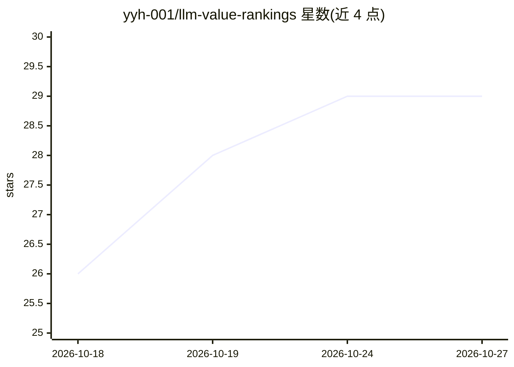

# yyh-001/llm-value-rankings

⭐ 29 · CSS · MIT · 推送 2026-10-25 · [GitHub](https://github.com/yyh-001/llm-value-rankings) · [官网](https://yyh-001.github.io/llm-value-rankings/) · 个人维护 · 中文 README

**每日更新的 300+ 大模型性价比排行榜静态站点**

静态站点（零后端、GitHub Pages 部署），每日由 GitHub Actions 拉取数据，对 300+ 文本输出 LLM 按价值分排序：价值分 = f(智力)^×速度^0.8/价格，f 为围绕均值的嵌套平方变换，归一化到 0–100。价格数据来自 OpenRouter 混合价及 7 个渠道（OpenCode Go、Command Code GOAT、DeepSeek 官方 API、GPT Plus、MiniMax/MiMo Token Plan 等），支持按最低渠道价重排；智力分来自 Artificial Analysis Intelligence Index。提供双语 UI、Pareto 图、日环比变化等。限制：智力分低于 25、名称含 distill、缺价格或智力数据的模型被排除；图像生成模型不参与排名。

## 筛选速览

| 维度 | 判定 | 备注 |
|---|---|---|
| AI 角色 | `ai-knowledge` | 知识聚合/清单类 |
| 许可风险 | `permissive` | MIT |
| 部署形态 | `library` | 以包/库形式分发 |
| 模型依赖 | — | README 未给出锁定关系 |
| 硬件要求 | — | 无带数字的原话,不猜 |
| 安装摩擦 | `low` | 无编译、无系统依赖或容器化 |
| 成熟度 | — | 结构信号不足 |

## 能力要点

- 价值分公式 f(智力)×速度^0.8/价格，含嵌套平方变换与 0–100 归一化
- 7 渠道价格对比并支持按最低渠道价重排（默认关闭）
- GitHub Actions 每日自动更新数据，纯静态无后端
- 中英双语 UI、多主题、Pareto 图与日环比排名变化

## 适用场景

- 挑选单位价格智力产出更高的大模型
- 对比同一模型在不同渠道/订阅方案下的价格
- 跟踪模型排名的每日变化

## 场景标签

`模型评测` · 领域:评测与运维

## 证据(README 行号)

> L17: LLM Value Rankings compares **300+ LLMs** by combining:
> L25: The result is a daily-updated leaderboard that answers one question: **how much AI capability do you get per dollar
> L46: |🤖|**Auto-updated**|GitHub Actions fetches fresh data daily|

## 星数曲线

2026-10-18 26 → 2026-10-27 29（+3）

---
*卡片 v1 · prompt 1.4 · 生成 2026-10-26 · 置信度 mid · 依据 README sha `f35b0b7f7a86` · [字段定义](../../DATASET.md)*
