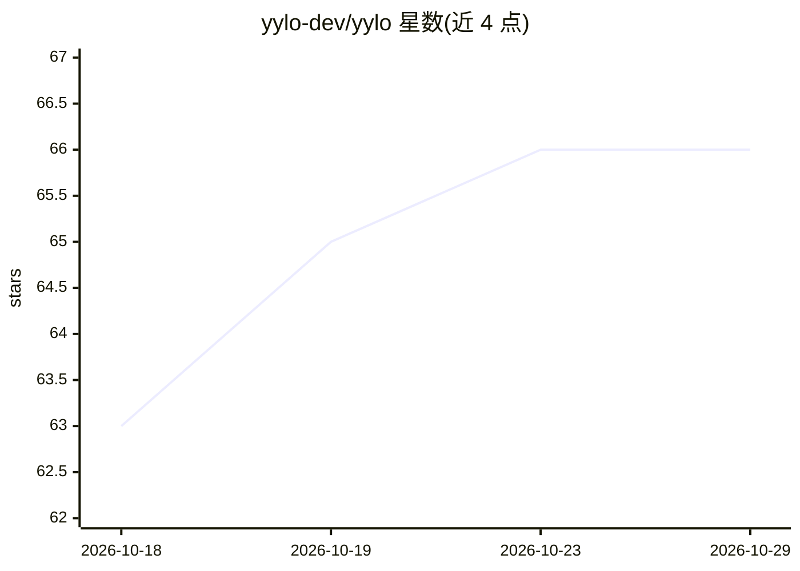

# yylo-dev/yylo

⭐ 66 · Python · MIT · 推送 2026-10-23 · [GitHub](https://github.com/yylo-dev/yylo) · [官网](https://yylo.dev) · 个人维护

**面向开发者的编码代理编排 CLI，提供任务/合并/工作流边界**

YYLO 是命令行编码代理编排器：运行代理会话（如 Pi）、执行迭代受限的循环工作流（flow.yaml、YYLO_LOOP_* 元数据）、管理类型化任务生命周期与基于原生 Git 的受保护合并交付，并以回执（receipt）记录仓库变更。面向需要快速代理循环的开发者与需要任务/验证/合并/发布边界的项目运营者。Ledger 与 Benchmark 为独立安装的委托包；代理运行时与模型凭证需外部安装配置；技能内容独立版本化于 yylo-skills 仓库。提供等价的 yylo 与 yy 命令，通过 npm 全局安装，要求 Node.js 20.10+ 与 Git。

## 筛选速览

| 维度 | 判定 | 备注 |
|---|---|---|
| AI 角色 | `ai-ecosystem` | LLM/agent 周边工具 |
| 许可风险 | `permissive` | MIT |
| 部署形态 | `library` | 以包/库形式分发 |
| 模型依赖 | — | README 未给出锁定关系 |
| 硬件要求 | — | 无带数字的原话,不猜 |
| 安装摩擦 | `low` | 无编译、无系统依赖或容器化 |
| 成熟度 | — | 结构信号不足 |

## 能力要点

- 类型化任务生命周期与受保护的原生 Git 合并（merge land/project）
- 迭代受限的代理循环与可复用 flow.yaml 工作流
- 回执式仓库变更记录与只读 watch 观察通道
- yy ledger / yy benchmark 透明委托独立安装的 Record 与评测包

## 适用场景

- 以受限迭代循环驱动编码代理完成验证增量
- 管理任务、集成分支与受保护的合并交付流程
- 用 JSON/NDJSON 严格机器输出接入 CI 流水线

## 场景标签

`编码 Agent` · 领域:编码与开发

## 证据(README 行号)

> L5: YYLO is a command-line orchestrator for coding agents, repeatable workflows, and receipt-backed repository changes. 
> L11: YYLO orchestrates work. YYLO Ledger is the independent Git-native Record/task store, and YYLO Benchmark is the inde

## 星数曲线

2026-10-18 63 → 2026-10-29 66（+3）

---
*卡片 v1 · prompt 1.4 · 生成 2026-10-24 · 置信度 mid · 依据 README sha `b0d349392a07` · [字段定义](../../DATASET.md)*
