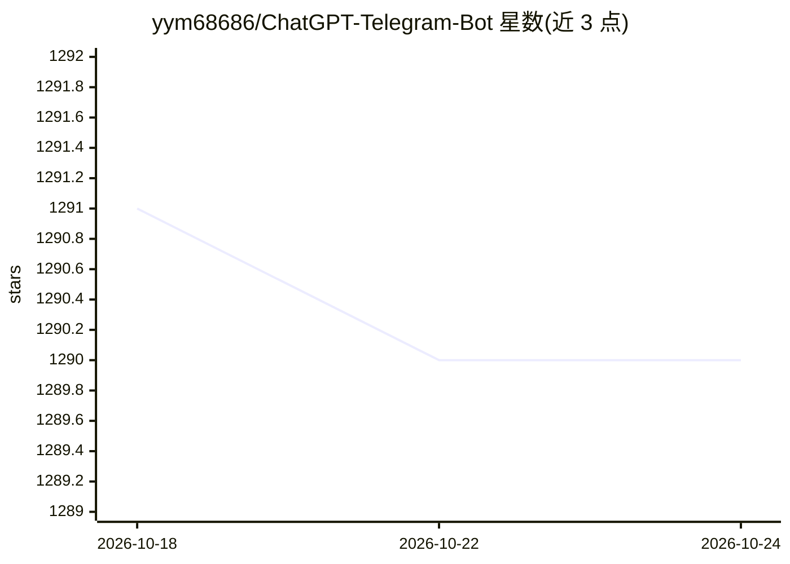

# yym68686/ChatGPT-Telegram-Bot

⭐ 1,290 · Python · GPL-3.0 · 推送 2026-04-06 · [GitHub](https://github.com/yym68686/ChatGPT-Telegram-Bot) · 个人维护 · 中文 README

**Telegram AI 聊天机器人：接入 OpenAI 兼容 API 对话与联网搜索**

用 Python 编写的 Telegram 机器人，支持 OpenAI 兼容的大模型 API，提供多模态问答（语音/图片/PDF/TXT/MD/Python 文件）、模型分组、群组话题隔离、DuckDuckGo/Google 联网搜索、URL 与 ArXiv 论文摘要、代码解释器与图像生成等插件，并支持多用户对话隔离、多语言界面与白名单管理。Anthropic、Gemini、Azure、AWS、Groq 等其他厂商模型需经作者的 uni-api 项目接入。支持 Docker 及 Koyeb/Zeabur/Replit 等一键部署。

## 筛选速览

| 维度 | 判定 | 备注 |
|---|---|---|
| AI 角色 | `ai-native` | 本体是模型或模型工具 |
| 许可风险 | `viral` | GPL-3.0 |
| 部署形态 | `self-host` | docker 或自建部署 |
| 模型依赖 | — | README 未给出锁定关系 |
| 硬件要求 | — | 无带数字的原话,不猜 |
| 安装摩擦 | `low` | 无编译、无系统依赖或容器化 |
| 成熟度 | — | 结构信号不足 |

## 能力要点

- 支持语音、图片、PDF 等多模态文件问答
- 插件系统：联网搜索、URL/ArXiv 摘要、代码解释器、图像生成
- 多用户对话隔离与群组话题模式
- Koyeb/Zeabur/Replit 一键部署与 Docker/fly.io 部署

## 适用场景

- 在 Telegram 里直接与 GPT 类模型对话并联网搜索
- 群聊中 @机器人即时获得回答
- 上传论文或文档让机器人做摘要问答

## 场景标签

`聊天机器人` `多模态` · 领域:对话与助手

## 证据(README 行号)

> L15: ChatGPT Telegram Bot is a powerful Telegram bot that supports OpenAI-compatible large language model APIs. It enabl
> L20: - **Multimodal Question Answering**: Supports question answering for voice, audio, images, and PDF/TXT/MD/python do

## 星数曲线

2026-10-18 1,291 → 2026-10-24 1,290（-1）

---
*卡片 v1 · prompt 1.4 · 生成 2026-10-21 · 置信度 high · 依据 README sha `14560f0fbe5e` · [字段定义](../../DATASET.md)*
