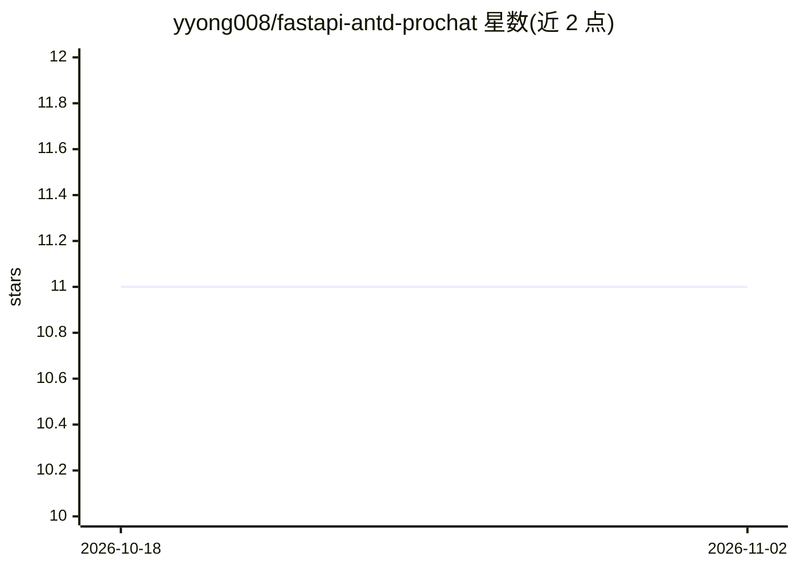

# yyong008/fastapi-antd-prochat

⭐ 11 · TypeScript · MIT · 推送 2026-05-11 · [GitHub](https://github.com/yyong008/fastapi-antd-prochat) · 个人维护 · 中文 README

**基于 FastAPI+React 的 AI 聊天应用模板：接入智谱 GLM**

一个全栈 AI 对话应用脚手架：后端用 Python（poetry）+ FastAPI + LangChain，前端用 React + Ant Design ProChat + TanStack Router + TailwindCSS，AI 侧接入智谱（zhipu）的 glm-4-flash 模型。数据存储使用本地部署的 supabase，需注册智谱账号获取 API key 并配置环境变量。支持新建聊天与对话的增删改查，访问地址分别为前端 5173 与后端 8000 端口。面向想快速搭建自有 AI 聊天服务的开发者。

## 筛选速览

| 维度 | 判定 | 备注 |
|---|---|---|
| AI 角色 | `ai-native` | 本体是模型或模型工具 |
| 许可风险 | `permissive` | MIT |
| 部署形态 | `library` | 以包/库形式分发 |
| 模型依赖 | — | README 未给出锁定关系 |
| 硬件要求 | — | 无带数字的原话,不猜 |
| 安装摩擦 | `low` | 无编译、无系统依赖或容器化 |
| 成熟度 | — | 结构信号不足 |

## 能力要点

- 前后端分离：FastAPI + LangChain 后端，React + Ant Design ProChat 前端
- 接入智谱 glm-4-flash 模型
- supabase 本地存储，支持聊天增删改查

## 适用场景

- 快速搭建一个可自托管的 AI 聊天应用
- 作为 FastAPI + React 全栈 AI 项目的学习模板
- 体验智谱 GLM 模型的对话交互

## 场景标签

`聊天机器人` · 领域:对话与助手

## 证据(README 行号)

> L5: - 后端：Python (poetry) + fastapi + langchain
> L8: - AI: zhipu（glm-4-flash 模型）

## 星数曲线

2026-10-18 11 → 2026-11-02 11（+0）

---
*卡片 v1 · prompt 1.4 · 生成 2026-11-01 · 置信度 high · 依据 README sha `854a6044a698` · [字段定义](../../DATASET.md)*
