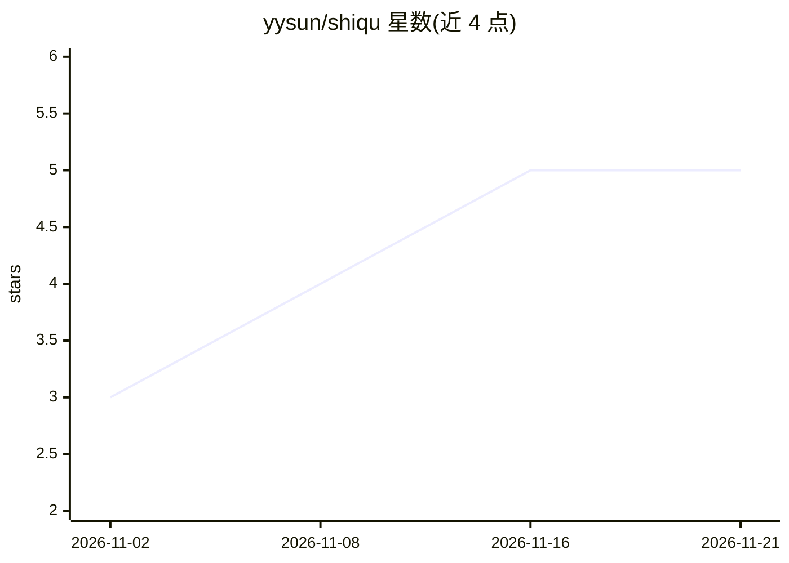

# yysun/shiqu

⭐ 5 · HTML · Apache-2.0 · 推送 2026-11-15 · [GitHub](https://github.com/yysun/shiqu) · 个人维护 · 中文 README

**用 AI 把中国古典故事生成连环画的本地应用**

拾趣是一个基于 Tauri 的本地应用，内置 26 部书籍与 12,024 张故事卡，调用已配置的生成模型将古典故事分镜并生成为连环画插图，支持 15 种画风。故事、图片与阅读进度保存在本地，支持电脑与手机阅读，可导出 PDF、PNG 长图和 ZIP。生成服务可选 Codex 订阅、OpenAI API 或 Gemini；连接本机 Ollama 嵌入模型可建立语义检索索引。桌面安装包未签名，API 密钥以明文保存在本机设置数据库中。

## 筛选速览

| 维度 | 判定 | 备注 |
|---|---|---|
| AI 角色 | `ai-native` | 本体是模型或模型工具 |
| 许可风险 | `permissive` | Apache-2.0 |
| 部署形态 | `library` | 以包/库形式分发 |
| 模型依赖 | local-ok | 支持本地模型 |
| 硬件要求 | — | 无带数字的原话,不猜 |
| 安装摩擦 | `low` | 无编译、无系统依赖或容器化 |
| 成熟度 | — | 结构信号不足 |

## 能力要点

- 内置 26 部书籍与 12,024 张故事卡，支持按主题/情节语义检索
- 可选 Codex 订阅、OpenAI API 或 Gemini 三种生成后端
- 导出 PDF/PNG 长图/ZIP，导出本地完成且保留署名与 AI 披露
- 可作为 Codex Skill 安装，由 Codex 代理制作连环画

## 适用场景

- 把《西游记》《庄子》等古典故事做成连环画给孩子或自己阅读
- 同局域网手机扫码接着阅读电脑上生成的作品
- 将完成的连环画导出 PDF 打印或 ZIP 投稿到在线作品集

## 场景标签

`图像生成` · 领域:内容生成

## 证据(README 行号)

> L3: 用拾趣，把中国古典故事变成你自己的连环画。内置 26 部书籍、15 种画风，支持电脑与手机阅读，以及 PDF、PNG 长图和 ZIP 导出。故事、图片和阅读进度保存在你的电脑上。
> L15: AI 生成服务可选 Codex 订阅、OpenAI API 或 Gemini。Codex 订阅需 macOS / Linux 并安装和登录 Codex CLI；OpenAI API 与 Gemini 使用各自 API 密钥并单独计
> L11: 应用随包带有 26 本书的 **12,024 张故事卡**。系统会调用已配置的生成模型，分批核对故事卡标题和梗概，匹配相关主题或情节。如果连接本机 Ollama 嵌入模型（如 qwen3-embedding:0.6b），即可按书建

## 星数曲线

2026-11-02 3 → 2026-11-21 5（+2）

---
*卡片 v1 · prompt 1.4 · 生成 2026-11-20 · 置信度 high · 依据 README sha `fb0100997ceb` · [字段定义](../../DATASET.md)*
