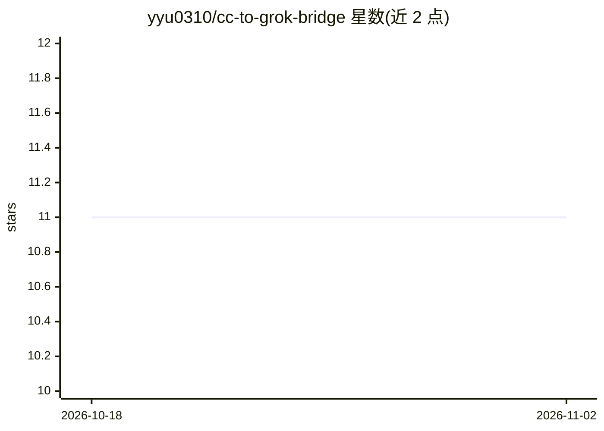

# yyu0310/cc-to-grok-bridge

⭐ 11 · Python · MIT · 推送 2026-10-28 · [GitHub](https://github.com/yyu0310/cc-to-grok-bridge) · 个人维护 · 中文 README

**把 Claude Code 配置桥接到 Grok Build 的适配层**

面向已用 Claude Code 的开发者，将其 rules/skills/hooks/memory 迁移复用到 Grok Build：系统提示指向同一 CLAUDE.md，复用 ~/.claude/commands 技能，通过 hook_adapter.py 翻译 Grok 与 CC 的 stdin 字段名和 deny 协议以保留安全硬阻断，另有 CC→Grok 内存同步（可选受限回推）与按类型重装 MCP 的指引。兼容性按 System Prompt/skill/Memory 高、Hooks/MCP 中、Plugins 低给出矩阵。要求 macOS/Linux + Python 3.10 + 双方 CLI 已就绪，桥接脚本本身无需 API key，git clone 源码安装。

## 筛选速览

| 维度 | 判定 | 备注 |
|---|---|---|
| AI 角色 | `ai-ecosystem` | LLM/agent 周边工具 |
| 许可风险 | `permissive` | MIT |
| 部署形态 | `None` |  |
| 模型依赖 | locked-api |  |
| 硬件要求 | — | 无带数字的原话,不猜 |
| 安装摩擦 | `low` | 无编译、无系统依赖或容器化 |
| 成熟度 | — | 结构信号不足 |

## 能力要点

- hook 适配器翻译 Grok/CC 的 payload 与 deny 协议，复用既有 CC 安全脚本实现硬阻断
- 复用同一 CLAUDE.md 系统提示与 ~/.claude/commands 技能集（含 symlink）
- CC→Grok 内存拉取 + 三区隔离，可选受限回推 general/
- 按兼容性矩阵（提示/技能/内存高、Hooks/MCP 中、插件低）列明各域差距

## 适用场景

- 把现有 Claude Code 的规则、技能与安全 hook 带到 Grok Build 上继续使用
- 在同一工作区内让 Grok 沿用 CC 的敏感文件读取阻断策略
- 统一管理双 CLI 的记忆与 MCP 配置迁移

## 场景标签

 · 领域:AI 编码工具/开发者工具

## 证据(README 行号)

> L5: Bridge **Claude Code** → **Grok Build**: reuse rules / skills, run the same hook hard-gates via an adapter, optional
> L13: |Hooks|Call your existing Claude Code security scripts through a thin adapter that translates allow/deny for Grok (
> L58: So you cannot point Grok straight at CC scripts. A thin **adapter** (`scripts/hook_adapter.py`) sits in the middle:

## 星数曲线

2026-10-18 11 → 2026-11-02 11（+0）

---
*卡片 v1 · prompt 1.4 · 生成 2026-11-01 · 置信度 high · 依据 README sha `721a0fdf1cd9` · [字段定义](../../DATASET.md)*
