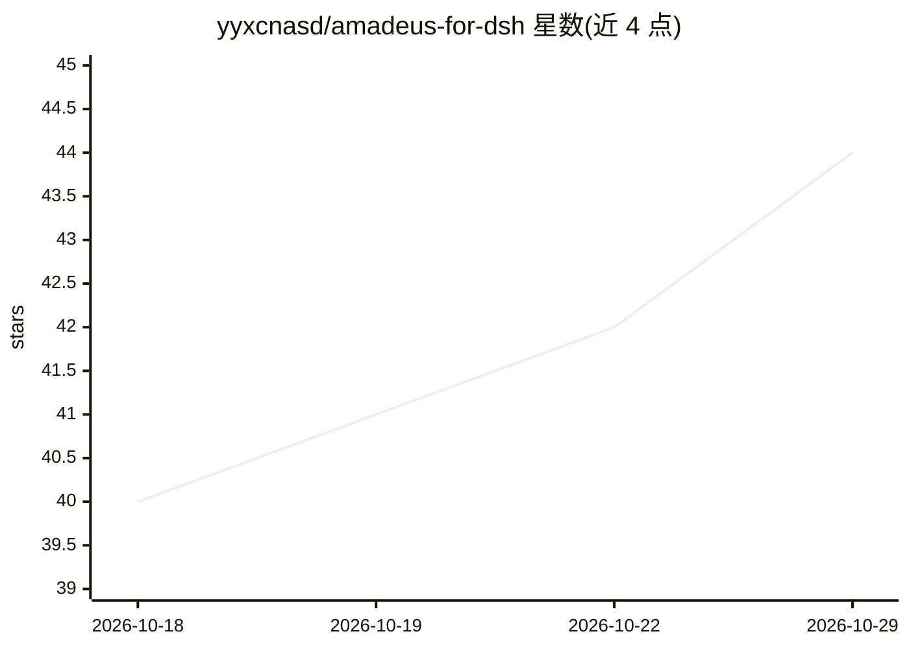

# yyxcnasd/amadeus-for-dsh

⭐ 44 · JavaScript · MIT · 推送 2026-10-09 · [GitHub](https://github.com/yyxcnasd/amadeus-for-dsh) · 个人维护 · 中文 README

**命运石之门0红莉栖 AI 助手插件：给 DSH 加 Live2D 聊天伴侣**

面向 DeepSeek Harness（DSH）的插件，以《命运石之门 0》牧濑红莉栖为形象的桌面伴侣：上屏 Live2D 立绘（呼吸/眨眼/说话嘴型），下屏聊天；提供红莉栖人格的 AI 聊天（日语语音+中文流式显示）、Edge TTS 等多种语音通道、词级口型同步、跨会话长期记忆、主动来电与事件播报、语音输入（浏览器识别降级 Whisper 后端）。通过 dsh plugin add 安装，支持 Windows/Linux/macOS，浏览器端与平台无关。素材为粉丝制作，声明禁止商用。

## 筛选速览

| 维度 | 判定 | 备注 |
|---|---|---|
| AI 角色 | `ai-native` | 本体是模型或模型工具 |
| 许可风险 | `permissive` | MIT |
| 部署形态 | `desktop` | 安装包/桌面程序 |
| 模型依赖 | — | README 未给出锁定关系 |
| 硬件要求 | — | 无带数字的原话,不猜 |
| 安装摩擦 | `low` | 无编译、无系统依赖或容器化 |
| 成熟度 | — | 结构信号不足 |

## 能力要点

- Live2D 立绘（呼吸/眨眼/嘴型/手势）+ 翻盖手机 UI
- 多种 TTS 通道：Edge TTS 默认，可切 VOICEVOX/Aqua-TTS/OpenAI 兼容
- 长期记忆落盘（历史+事实抽取），跨会话跨重启
- 主动来电、事件日语播报、语音输入（降级 Whisper STT）

## 适用场景

- 在 DSH 侧栏获得红莉栖形象的 AI 聊天伴侣
- 长任务结束或目标完成时收到日语语音播报
- 想要带长期记忆和主动互动的桌面 AI 伙伴

## 场景标签

`AI 助手` `语音 Agent` `Agent 记忆` · 领域:Agent 开发

## 证据(README 行号)

> L3: 《命运石之门 0》Amadeus —— 牧濑红莉栖（Makise Kurisu）智能助手，DeepSeek Harness 插件。
> L107: - **AI 聊天**：红莉栖人格（毒舌傲娇），日语语音 + 中文流式显示；可选独立 OpenAI 兼容 API。
> L105: - **实时语音**：默认 Edge TTS（免费开箱即用），可切 VOICEVOX / Aqua-TTS / OpenAI 兼容 / VOICEVOX 公共 API；默认「声线稳定」不自动切音色；按情感着色（12+ 情绪）。

## 星数曲线

2026-10-18 40 → 2026-10-29 44（+4）

---
*卡片 v1 · prompt 1.4 · 生成 2026-10-25 · 置信度 mid · 依据 README sha `4ba81670f147` · [字段定义](../../DATASET.md)*
