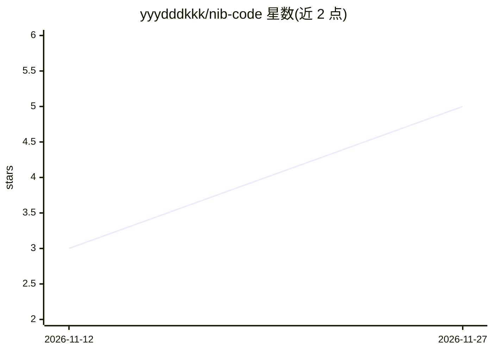

# yyydddkkk/nib-code

⭐ 5 · Zig · MIT · 推送 2026-11-26 · [GitHub](https://github.com/yyydddkkk/nib-code) · 个人维护 · 中文 README

**轻量级命令行编码 agent：单脚本读改检项目**

以 Zig 编写、嵌入 QuickJS 的终端编码 agent。核心机制是 Run：模型在单步中写出一个 JavaScript 脚本完成读取、编辑与检查，每个 Run 汇总为一个可点击查看 diff 与结果的块。支持交互模式、单次提问、会话续接，通过 /provider 登录 Codex、Claude、OpenAI、DeepSeek、Grok 或自定义端点；提供 hooks、MCP、插件与 AGENTS.md 约定。安装脚本写入 ~/.local/bin，源码构建需 Zig 0.17。沙箱模式下写操作限于项目目录、临时目录与构建缓存。

## 筛选速览

| 维度 | 判定 | 备注 |
|---|---|---|
| AI 角色 | `ai-ecosystem` | LLM/agent 周边工具 |
| 许可风险 | `permissive` | MIT |
| 部署形态 | `None` |  |
| 模型依赖 | — | README 未给出锁定关系 |
| 硬件要求 | — | 无带数字的原话,不猜 |
| 安装摩擦 | `low` | 无编译、无系统依赖或容器化 |
| 成熟度 | — | 结构信号不足 |

## 能力要点

- 单步 JavaScript 脚本完成读取、编辑与检查（Run 机制）
- 6.7 MB 静态 Linux x86-64 二进制，无运行时依赖
- 支持 MCP 服务器与插件（skills/commands/MCP 打包）
- Landlock/sandbox-exec 沙箱限制写操作范围

## 适用场景

- 在终端里让 agent 读取、修改并测试项目代码
- 用 /provider 切换多家模型服务或自定义端点
- 通过 MCP 与插件扩展 agent 的技能与命令

## 场景标签

`编码 Agent` · 领域:编码与开发

## 证据(README 行号)

> L7: A small, focused, quiet coding agent.
> L9: nib works in Runs: the model writes one JavaScript script that reads, edits and checks your project in a single step
> L56: Run `nib`, then `/provider` to sign in; `/model` picks a model. Codex, Claude, OpenAI, DeepSeek, Grok or your own e

## 星数曲线

2026-11-12 3 → 2026-11-27 5（+2）

---
*卡片 v1 · prompt 1.4 · 生成 2026-11-21 · 置信度 high · 依据 README sha `38db2bfe1a4f` · [字段定义](../../DATASET.md)*
