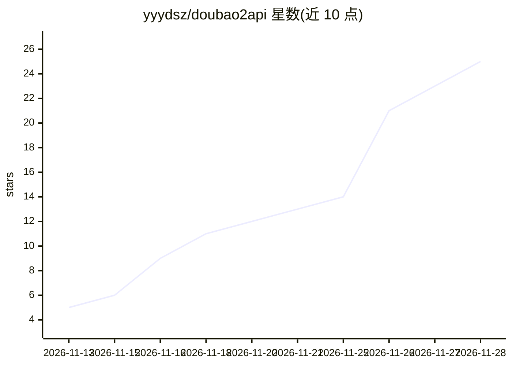

# yyydsz/doubao2api

⭐ 25 · HTML · MIT · 推送 2026-11-27 · [GitHub](https://github.com/yyydsz/doubao2api) · 个人维护 · 中文 README

**把豆包工作模式包装成 OpenAI 兼容接口的网关与号池管理面板**

Go 编写的单二进制网关，将豆包客户端「工作模式」的 /chat/completion 协议翻译为 OpenAI 兼容接口，支持流式/非流式、10 个可切换模型与按模型的 memory_profile 配置；附带 Cookie 账号池（会话粘性、冷却、每日签到）与多密钥分发。另提供单文件 Python（FastAPI）管理面板，含账号、密钥、模型、请求日志与测试台共 8 个页签。README 声明本项目为协议研究用途，仅支持文本消息。

## 筛选速览

| 维度 | 判定 | 备注 |
|---|---|---|
| AI 角色 | `ai-ecosystem` | LLM/agent 周边工具 |
| 许可风险 | `permissive` | MIT |
| 部署形态 | `library` | 以包/库形式分发 |
| 模型依赖 | — | README 未给出锁定关系 |
| 硬件要求 | — | 无带数字的原话,不猜 |
| 安装摩擦 | `low` | 无编译、无系统依赖或容器化 |
| 成熟度 | — | 结构信号不足 |

## 能力要点

- 协议翻译层：messages[] 与豆包 content_block/SSE 事件双向转换
- Cookie 账号池：会话粘性、冷却/停用、每日自动签到领额度
- 多密钥分发并按密钥统计 token 用量（SSE 无 usage，按字符折算估算）
- 网关零第三方 Go 依赖，管理接口仅限回环地址访问

## 适用场景

- 用 OpenAI SDK 或现有客户端直接调用豆包工作模式里的模型
- 自建多账号号池并对多个使用者分发密钥、统计用量
- 通过管理面板测试不同模型的思考强度与流式输出

## 场景标签

`模型网关` · 领域:Agent 开发

## 证据(README 行号)

> L3: 把**豆包客户端「工作模式」**的 `/chat/completion` 协议包装成 **OpenAI 兼容**接口，附带号池、密钥分发、额度与签到管理面板。
> L5: 单二进制 Go 网关 + 单文件 Python 面板，网关零第三方 Go 依赖。

## 星数曲线

2026-11-13 5 → 2026-11-28 25（+20）

---
*卡片 v1 · prompt 1.4 · 生成 2026-11-18 · 置信度 high · 依据 README sha `7c8a49830a4d` · [字段定义](../../DATASET.md)*
