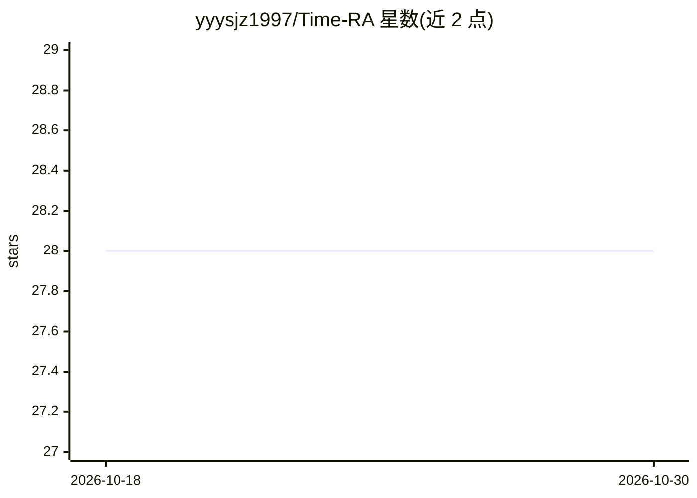

# yyysjz1997/Time-RA

⭐ 28 · Python · 推送 2026-01-10 · [GitHub](https://github.com/yyysjz1997/Time-RA) · [官网](https://arxiv.org/abs/2507.15066) · 个人维护

**面向时序异常诊断的多模态推理框架，附 RATs40K 数据集**

Time-RA 是一个将 LLM 反馈引入时序异常诊断的多模态推理框架，覆盖多任务时序异常检测场景，配套的 RATs40K 数据集已开源供下载。README 仅呈现标题、ArXiv 论文入口、数据集下载说明与工作流示意图（Figure 1），未给出安装命令、运行方式或依赖说明。整体面向时序异常检测与数据挖掘方向的研究场景，以论文与数据集形式发布。

## 筛选速览

| 维度 | 判定 | 备注 |
|---|---|---|
| AI 角色 | `ai-native` | 本体是模型或模型工具 |
| 许可风险 | `none` | — |
| 部署形态 | `None` |  |
| 模型依赖 | — | README 未给出锁定关系 |
| 硬件要求 | — | 无带数字的原话,不猜 |
| 安装摩擦 | `low` | 无编译、无系统依赖或容器化 |
| 成熟度 | — | 结构信号不足 |

## 能力要点

- 多模态推理框架，用于多任务时序异常检测
- 引入 LLM 反馈进行异常诊断推理
- 配套 RATs40K 数据集已开源可下载

## 适用场景

- 研究者复现论文中的时序异常诊断方法
- 使用 RATs40K 数据集开展时序异常检测实验

## 场景标签

 · 领域:时序数据挖掘/异常检测

## 证据(README 行号)

> L2: Time-RA: Towards Time Series Reasoning for Anomaly Diagnosis with LLM Feedback [ArXiv]
> L8: |*Figure 1. The Time-RA workflow: A novel multimodal reasoning framework for multi-task time series anomaly detectio

## 星数曲线

2026-10-18 28 → 2026-10-30 28（+0）

---
*卡片 v1 · prompt 1.4 · 生成 2026-10-26 · 置信度 mid · 依据 README sha `9d55400c4e84` · [字段定义](../../DATASET.md)*
