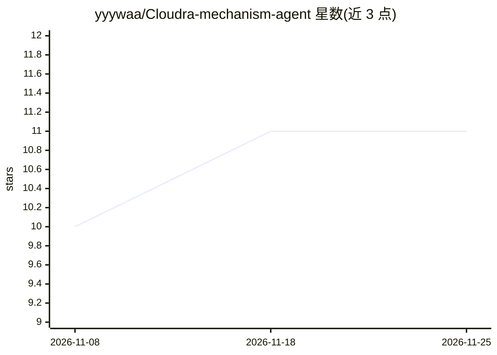

# yyywaa/Cloudra-mechanism-agent

⭐ 11 · Python · AGPL-3.0 · 推送 2026-11-23 · [GitHub](https://github.com/yyywaa/Cloudra-mechanism-agent) · 组织维护 · 中文 README

**面向化学家的多智能体计算化学研究助手**

面向理论与实验化学家的 AI agent，聚焦有机小分子反应机理的计算探索，通过自然语言下达计算化学任务，支持文献检索、代码编写等通用科研辅助。控制台可查看 agent 论坛讨论、工具结果、自带的 HPC 调度队列与原生日志；提供三种工作模式（standard/dag_record/dag_guided），dag_guided 模式可自主完成单反应机理探索并交付。提供 macOS/Linux/Windows 安装包，也可从源码安装，需自行配置协调者/跟随者模型与计算节点（含 Slurm 集群部署指南）。

## 筛选速览

| 维度 | 判定 | 备注 |
|---|---|---|
| AI 角色 | `ai-native` | 本体是模型或模型工具 |
| 许可风险 | `viral` | AGPL-3.0 |
| 部署形态 | `desktop` | 安装包/桌面程序 |
| 模型依赖 | — | README 未给出锁定关系 |
| 硬件要求 | — | 无带数字的原话,不猜 |
| 安装摩擦 | `low` | 无编译、无系统依赖或容器化 |
| 成熟度 | — | 结构信号不足 |

## 能力要点

- 自然语言描述计算化学任务，多 agent 协作执行
- 内置小型 HPC 调度器管理计算队列，支持 Slurm 远程集群
- 机理图模式记录/引导物种、反应步骤与证据状态
- 附 arXiv 论文、50 任务基准库与可复现的 P2 数据归档

## 适用场景

- 给定反应物与产物，探索反应路径与机理
- 查找文献并为研究编写计算脚本
- 在 Slurm 集群上部署远程计算并跟踪任务进度

## 场景标签

`多智能体` `科研工具` · 领域:Agent 开发

## 证据(README 行号)

> L11: Meet Cloudra, an agent for theoretical and experimental chemists.
> L31: In the console, you can follow agent discussions in the agent forum, inspect tool results, view the calculation que

## 星数曲线

2026-11-08 10 → 2026-11-25 11（+1）

---
*卡片 v1 · prompt 1.4 · 生成 2026-11-18 · 置信度 mid · 依据 README sha `07501460227c` · [字段定义](../../DATASET.md)*
