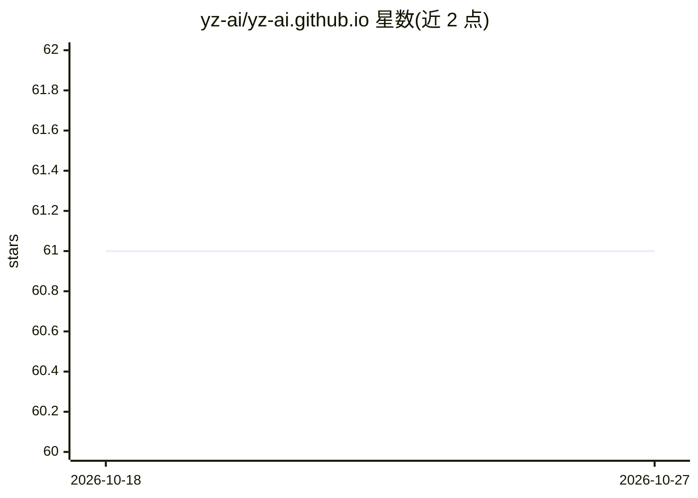

# yz-ai/yz-ai.github.io

⭐ 61 · JavaScript · 推送 2026-06-23 · [GitHub](https://github.com/yz-ai/yz-ai.github.io) · [官网](https://yz-ai.github.io/) · 组织维护

**土耳其语 AI 学习平台：深度学习等领域的项目、论文与教程**

名为 Yapay Zekâ Araştırma İnisiyatifi（人工智能研究倡议）的 GitHub Pages 站点，以土耳其语呈现。内容覆盖深度学习、计算机视觉、自然语言处理与强化学习四个领域的项目、学术出版物、教育资源和博客文章。README 仅含标题与简介，未给出具体安装或运行方式，属于内容展示型静态站点仓库。

## 筛选速览

| 维度 | 判定 | 备注 |
|---|---|---|
| AI 角色 | `ai-knowledge` | 知识聚合/清单类 |
| 许可风险 | `none` | — |
| 部署形态 | `None` |  |
| 模型依赖 | — | README 未给出锁定关系 |
| 硬件要求 | — | 无带数字的原话,不猜 |
| 安装摩擦 | `low` | 无编译、无系统依赖或容器化 |
| 成熟度 | — | 结构信号不足 |

## 能力要点

- 聚合深度学习/计算机视觉/NLP/强化学习四个领域内容
- 收录项目、学术出版物、教育资源与博客四类材料
- 土耳其语内容平台

## 适用场景

- 查找土耳其语的深度学习与 CV 学习资源
- 跟进该倡议的学术出版物与项目
- 阅读 AI 领域的土耳其语博客文章

## 场景标签

`教程课程` `精选清单` · 领域:学习与行业

## 证据(README 行号)

> L2: Derin Öğrenme, Bilgisayarlı Görü, Doğal Dil İşleme ve Pekiştirmeli Öğrenme alanlarındaki **projeler**, **akademik ya

## 星数曲线

2026-10-18 61 → 2026-10-27 61（+0）

---
*卡片 v1 · prompt 1.4 · 生成 2026-10-24 · 置信度 mid · 依据 README sha `182dea5576ad` · [字段定义](../../DATASET.md)*
