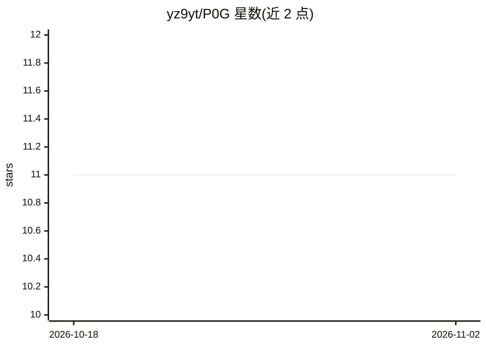

# yz9yt/P0G

⭐ 11 · Shell · MIT · 推送 2026-03-13 · [GitHub](https://github.com/yz9yt/P0G) · 个人维护

**给 Google Antigravity 的分阶段软件开发工作流方法论，防上下文遗忘**

面向 Google Antigravity 平台的软件开发方法论与工作流文件集：将项目拆为发现、规划、任务分解、执行四个顺序阶段，各阶段对应一个斜杠命令与专用 agent 人设，另有一个随时可用的 /p0g-surgeon 复杂 bug 修复命令。核心机制是把所有状态存入文件（prd.json、progress.txt、AGENTS.md），每次 agent 调用从磁盘重建上下文以避免 Context Rot；任务须通过 shell 验证命令才算完成，代码修改前自动备份。通过 install.sh 一键脚本或 git clone 手动安装，不改动既有代码。附可选函数式范式规则模板。

## 筛选速览

| 维度 | 判定 | 备注 |
|---|---|---|
| AI 角色 | `ai-ecosystem` | LLM/agent 周边工具 |
| 许可风险 | `permissive` | MIT |
| 部署形态 | `None` |  |
| 模型依赖 | — | README 未给出锁定关系 |
| 硬件要求 | — | 无带数字的原话,不猜 |
| 安装摩擦 | `low` | 无编译、无系统依赖或容器化 |
| 成熟度 | — | 结构信号不足 |

## 能力要点

- 4 个顺序阶段 + 1 个反应式 bug 修复命令，阶段不可跳过
- 全部状态存文件，每次调用从磁盘重建上下文
- 任务须通过验证命令（exit code 0）才能标记完成，失败自动重试最多 3 次
- 每次代码修改前自动备份到 .p0g/backups/，可回滚

## 适用场景

- 在 Antigravity 中按阶段推进新项目从需求到可运行代码
- 长会话中防止 agent 遗忘既有决策与文件结构
- 让不同模型在同一项目上接力工作（状态可检视、可版本控制）

## 场景标签

`编码 Agent` · 领域:编码与开发

## 证据(README 行号)

> L10: P0G is a methodology for Google Antigravity that eliminates **Context Rot** — when the AI forgets decisions mid-pro
> L14: P0G splits every project into 4 sequential phases. Each phase has a dedicated slash command, a specialized agent pe

## 星数曲线

2026-10-18 11 → 2026-11-02 11（+0）

---
*卡片 v1 · prompt 1.4 · 生成 2026-11-01 · 置信度 high · 依据 README sha `c08113438904` · [字段定义](../../DATASET.md)*
