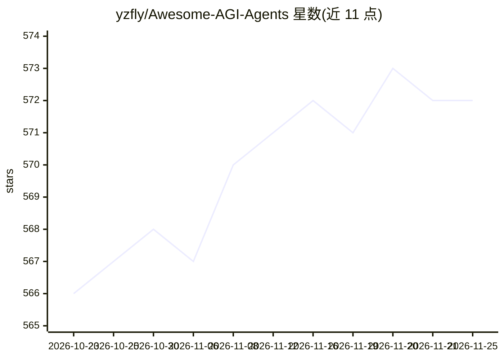

# yzfly/Awesome-AGI-Agents

⭐ 572 · NOASSERTION · 推送 2026-11-14 · [GitHub](https://github.com/yzfly/Awesome-AGI-Agents) · [官网](https://agents.art) · 个人维护 · 中文 README

**AI Agents 领域精选资源清单（文章/论文/项目/框架）**

以中英文双语表格组织的中立清单型仓库，按板块收录 AI Agent 相关资源：文章与视频、论文（LLM-Agent-Survey、Toolformer、AgentBench 等综述与基准）、2024-2026 活跃项目（LangGraph、CrewAI、MCP、A2A、Claude Code 等）、前沿项目与开发平台。条目附简介与 GitHub 链接，持续更新，自述早期内容主要覆盖 2023 年 Agent 生态。

## 筛选速览

| 维度 | 判定 | 备注 |
|---|---|---|
| AI 角色 | `ai-knowledge` | 知识聚合/清单类 |
| 许可风险 | `none` | NOASSERTION |
| 部署形态 | `None` |  |
| 模型依赖 | — | README 未给出锁定关系 |
| 硬件要求 | — | 无带数字的原话,不猜 |
| 安装摩擦 | `low` | 无编译、无系统依赖或容器化 |
| 成熟度 | `idea` | |

## 能力要点

- 按文章/论文/重要项目/前沿项目/开发平台分板块组织
- 收录 AgentBench、ClawBench 等评测基准与多篇综述论文清单
- 覆盖 MCP、A2A、Agent Skills 等协议类条目
- 持续更新，2024-2026 项目板块标注更新日期

## 适用场景

- 系统了解 AI Agent 领域的论文与综述脉络
- 查找可用的 Agent 框架、编码 Agent 与编排工具
- 调研 Agent 相关协议（MCP/A2A）与生态项目

## 场景标签

`精选清单` · 领域:学习与行业

## 证据(README 行号)

> L3: Agents (智能体) 精选资源合集，持续更新中
> L16: ## 论文
> L32: ## 2024-2026 重要项目

## 星数曲线

2026-10-23 566 → 2026-11-25 572（+6）

---
*卡片 v1 · prompt 1.4 · 生成 2026-11-25 · 置信度 high · 依据 README sha `244a526c1023` · [字段定义](../../DATASET.md)*
