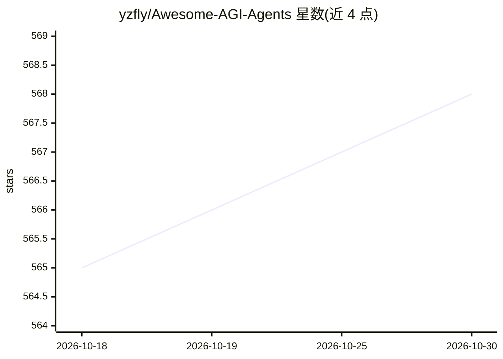

# yzfly/Awesome-AGI-Agents

⭐ 568 · NOASSERTION · 推送 2026-10-15 · [GitHub](https://github.com/yzfly/Awesome-AGI-Agents) · [官网](https://agents.art) · 个人维护 · 中文 README

**AGI/AI Agents 精选资源合集：文章、论文、项目与平台导航**

由个人维护的中文 AI Agent 资源清单，按文章视频、论文、2024-2026 重要项目、前沿项目、开发平台与 Curated List 分节组织。收录 AutoGPT、LangGraph、MCP、Claude Code、deepseek-harness 等项目条目并附简介，覆盖框架、协议、编码 Agent 与开发平台等类别。2026-08 进行过增补更新，含 2024-2026 新增项目一节。条目以表格形式列出，不提供可运行代码，采用 CC BY-NC 4.0 许可。

## 筛选速览

| 维度 | 判定 | 备注 |
|---|---|---|
| AI 角色 | `ai-knowledge` | 知识聚合/清单类 |
| 许可风险 | `none` | NOASSERTION |
| 部署形态 | `None` |  |
| 模型依赖 | — | README 未给出锁定关系 |
| 硬件要求 | — | 无带数字的原话,不猜 |
| 安装摩擦 | `low` | 无编译、无系统依赖或容器化 |
| 成熟度 | — | 结构信号不足 |

## 能力要点

- 按文章/论文/重要项目/前沿项目/开发平台分节的中文导航清单
- 2026-08 更新新增 deepseek-harness、Codex CLI、OpenClaw 等条目
- 覆盖 Agent 框架、协议（MCP/A2A/Agent Skills）与开发平台
- 采用 CC BY-NC 4.0（署名-非商业性使用）许可

## 适用场景

- 系统了解 AI Agent 领域的项目、论文与教程分布
- 为选型调研 Agent 框架、协议与开发平台
- 跟踪 2024-2026 年新增的 Agent 生态项目

## 场景标签

`精选清单` · 领域:学习与行业

## 证据(README 行号)

> L3: Agents (智能体) 精选资源合集，持续更新中
> L32: 本仓库早期内容主要覆盖 2023 年的 Agent 生态。以下为 2024-2026 年间崛起并经验证仍活跃的重要项目与协议（2026-08 更新：新增 deepseek-harness、Codex CLI、OpenClaw、He

## 星数曲线

2026-10-18 565 → 2026-10-30 568（+3）

---
*卡片 v1 · prompt 1.4 · 生成 2026-10-21 · 置信度 high · 依据 README sha `61496ffa2b56` · [字段定义](../../DATASET.md)*
