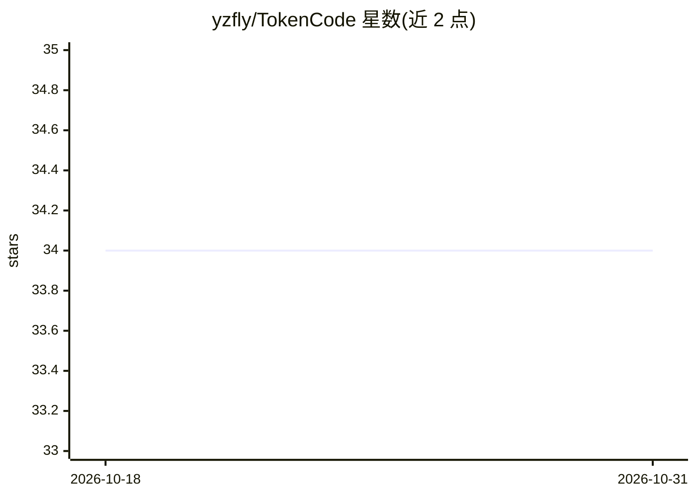

# yzfly/TokenCode

⭐ 34 · Go · NOASSERTION · 推送 2026-07-07 · [GitHub](https://github.com/yzfly/TokenCode) · 个人维护 · 中文 README

**Go 终端编码 agent：最多 1000 个 agent 并行竞赛解题、裁判择优**

单个 Go 静态二进制构成的终端编码 agent，走 Anthropic 协议，默认经 DeepSeek 的 Anthropic 兼容端点接入，支持 anthropic/openai/google 三种协议注册任意 provider（含本地 Ollama）。核心是 tool-use 循环，提供 read/write/edit/bash/git/websearch 等工具；`/race` 模式派最多 1000 个 agent 在隔离 git worktree 各自解同一道题，经客观粗筛+LLM 打分+决赛流水线择优，支持够好即收的预算取消机制。附带权限四模式与规则三表、文件检查点回滚、headless 与 HTTP API/WebUI、A2A 协议端点、飞书/钉钉/微信(实验性)团队接入、Claude Code 风格 hooks 与 Go 嵌入 SDK。限制：serve v0 无鉴权默认仅绑回环；bash 改动不在检查点回滚范围。

## 筛选速览

| 维度 | 判定 | 备注 |
|---|---|---|
| AI 角色 | `ai-native` | 本体是模型或模型工具 |
| 许可风险 | `none` | NOASSERTION |
| 部署形态 | `None` |  |
| 模型依赖 | local-ok | 支持本地模型 |
| 硬件要求 | — | 无带数字的原话,不猜 |
| 安装摩擦 | `low` | 无编译、无系统依赖或容器化 |
| 成熟度 | `idea` | |

## 能力要点

- /race 并行竞赛：最多 1000 个 agent 隔离 worktree 独立解题，裁判流水线择优，支持够好即收（败者退预算）
- 内置 141 个 provider 目录快照，国内 Coding Plan（Kimi/GLM/百炼/MiniMax/混元等）零配置接入
- 权限四模式+deny/ask/allow 规则三表，覆盖 TUI/headless/serve/IM 通道全路径
- serve 自带 WebUI 用量大盘、A2A 协议端点与飞书/钉钉长连接团队模式（免公网 IP）

## 适用场景

- 在终端用自然语言驱动 agent 读改文件、跑命令、查资料完成编码任务
- 对关键 bug 或任务并行跑多个 agent 方案，择优采纳
- 团队成员通过飞书/钉钉/微信各自驱动自己的工作空间
- CI/脚本中 headless 跑单轮任务或嵌入自己的 Go 程序

## 场景标签

`编码 Agent` `多智能体` · 领域:Agent 开发

## 证据(README 行号)

> L19: 一个跑在终端里的编码 agent：你说一句话，它用 `read` / `write` / `edit` / `bash`、`ls` / `glob` / `grep`（文件检索）、`git_status` / `git_diff`
> L34: 派 N 个 agent（N≤1000）**各自在隔离的 git worktree** 里独立解同一道题（文件工具被硬隔离在各自写空间），窗口化并发；跑完后裁判流水线择优——客观粗筛（空 diff / `race.check` 校验

## 星数曲线

2026-10-18 34 → 2026-10-31 34（+0）

---
*卡片 v1 · prompt 1.4 · 生成 2026-10-25 · 置信度 high · 依据 README sha `5606bed5a110` · [字段定义](../../DATASET.md)*
