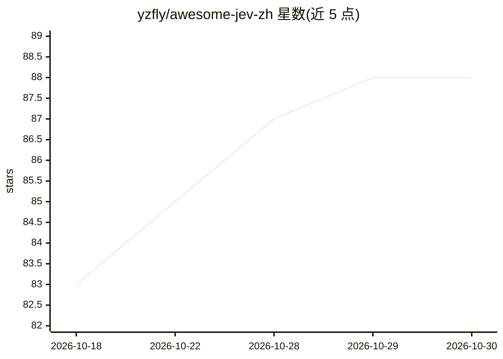

# yzfly/awesome-jev-zh

⭐ 88 · HTML · CC0-1.0 · 推送 2026-10-29 · [GitHub](https://github.com/yzfly/awesome-jev-zh) · [官网](https://code.jiangshu.ai/awesome-jev-zh/) · 个人维护 · 中文 README

**Jev / TypeSafe System One 中文精选清单：资料、SDK、应用与评测**

由个人维护的 Jev（TypeSafe System One 模型）中文生态精选列表：收录官方文档与博文、Star 过 500 的优质项目（浏览器 Agent、Agent 框架、上下文工程、开源复现）、体验渠道对比（classifier.dev 免费试用、Vercel AI Gateway、官方 API、本地复现），并附中文术语对照、上手指南、作者自测的中文场景小样本数据与独立复现评测（laya/kev/SemIf 延迟与准确率对比）。列表声明非官方、与 TypeSafe AI 无隶属关系，厂商自评数据均标注出处，另有每日自动收录的 GitHub 热门榜。

## 筛选速览

| 维度 | 判定 | 备注 |
|---|---|---|
| AI 角色 | `ai-knowledge` | 知识聚合/清单类 |
| 许可风险 | `viral` | CC0-1.0 |
| 部署形态 | `self-host` | docker 或自建部署 |
| 模型依赖 | — | README 未给出锁定关系 |
| 硬件要求 | — | 无带数字的原话,不猜 |
| 安装摩擦 | `low` | 无编译、无系统依赖或容器化 |
| 成熟度 | — | 结构信号不足 |

## 能力要点

- 收录 Star≥500 的 Jev 生态项目并按方向分类
- 整理五条体验渠道的门槛、计费与延迟对比
- 包含中文术语对照与中文工单路由小样本实测数据
- 对 laya/kev/SemIf 等开源复现做了延迟、硬件与准确率对比

## 适用场景

- 想系统了解 Jev 生态，找中文入门资料和官方文档入口
- 在免费试用、托管网关与本地复现之间选体验路径
- 对比开源复现方案（laya/kev/SemIf）的硬件需求与中文表现

## 场景标签

`精选清单` · 领域:学习与行业

## 证据(README 行号)

> L18: 这是 Jev 生态的中文精选列表，外加两份中文指南和一份 图解说明。
> L60: Star 过 500 的项目，全生态一共这些。时间有限就先看这一栏，方向从浏览器操作、Agent 框架、上下文工程一直排到几个能自己训的开源复现。

## 星数曲线

2026-10-18 83 → 2026-10-30 88（+5）

---
*卡片 v1 · prompt 1.4 · 生成 2026-10-24 · 置信度 mid · 依据 README sha `4e2d6bad528b` · [字段定义](../../DATASET.md)*
