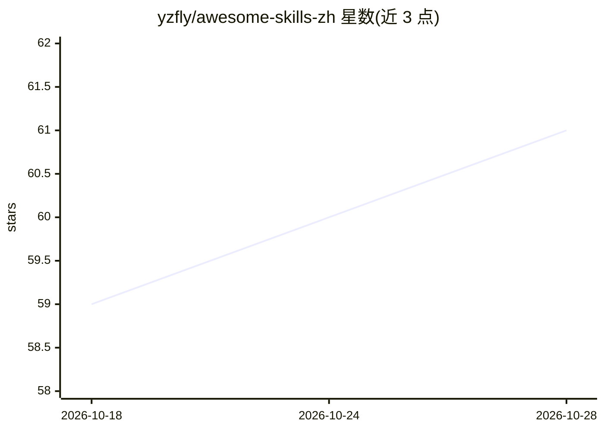

# yzfly/awesome-skills-zh

⭐ 61 · Apache-2.0 · 推送 2026-10-15 · [GitHub](https://github.com/yzfly/awesome-skills-zh) · 个人维护 · 中文 README

**中文版 Claude/Agent/LLM Skills 精选资源清单**

由个人维护者（云中江树/yzfly）维护的 awesome 类型中文清单，收录 Claude Skills、Agent Skills、LLM Skills 及 AI 智能体开发资源。当前可见内容包括设计类 Skills 专题（25 个条目），每个条目给出技能名称、来源仓库、功能描述、适用场景与安装调用方式；收录的技能兼容 Claude Code、Codex、Cursor、豆包等支持 Agent Skills 开放标准的宿主，并按纸刊海报、风格转译、品牌图标等类别组织。清单本身不含代码，条目按 GitHub Star 排序抓取。

## 筛选速览

| 维度 | 判定 | 备注 |
|---|---|---|
| AI 角色 | `ai-knowledge` | 知识聚合/清单类 |
| 许可风险 | `permissive` | Apache-2.0 |
| 部署形态 | `library` | 以包/库形式分发 |
| 模型依赖 | — | README 未给出锁定关系 |
| 硬件要求 | — | 无带数字的原话,不猜 |
| 安装摩擦 | `medium` | 含编译或系统依赖之一 |
| 成熟度 | — | 结构信号不足 |

## 能力要点

- 按类别组织的 Skills 条目，含来源仓库、功能与安装调用方式
- 收录技能遵循 Agent Skills 开放标准，可装入多种宿主 Agent
- 每条标注适用场景与许可限制（如非商用、Source-available）

## 适用场景

- 为 Claude Code/Codex 等宿主寻找现成的设计类图像生成 Skill
- 了解 Agent Skills 生态中照片转海报/插画类技能的覆盖情况
- 按 Star 排序快速定位热门 Skill 仓库

## 场景标签

`精选清单` · 领域:学习与行业

## 证据(README 行号)

> L3: > 🇨🇳 **中文**：精选 Claude Skills、Agent Skills、LLM Skills 及 AI 智能体开发资源列表。
> L4: > 🇺🇸 **English**: A curated list of awesome Claude Skills, Agent Skills, and AI resources.
> L6: **维护者 (Maintainer)**: 云中江树 (yzfly)

## 星数曲线

2026-10-18 59 → 2026-10-28 61（+2）

---
*卡片 v1 · prompt 1.4 · 生成 2026-10-24 · 置信度 mid · 依据 README sha `793429d3e985` · [字段定义](../../DATASET.md)*
