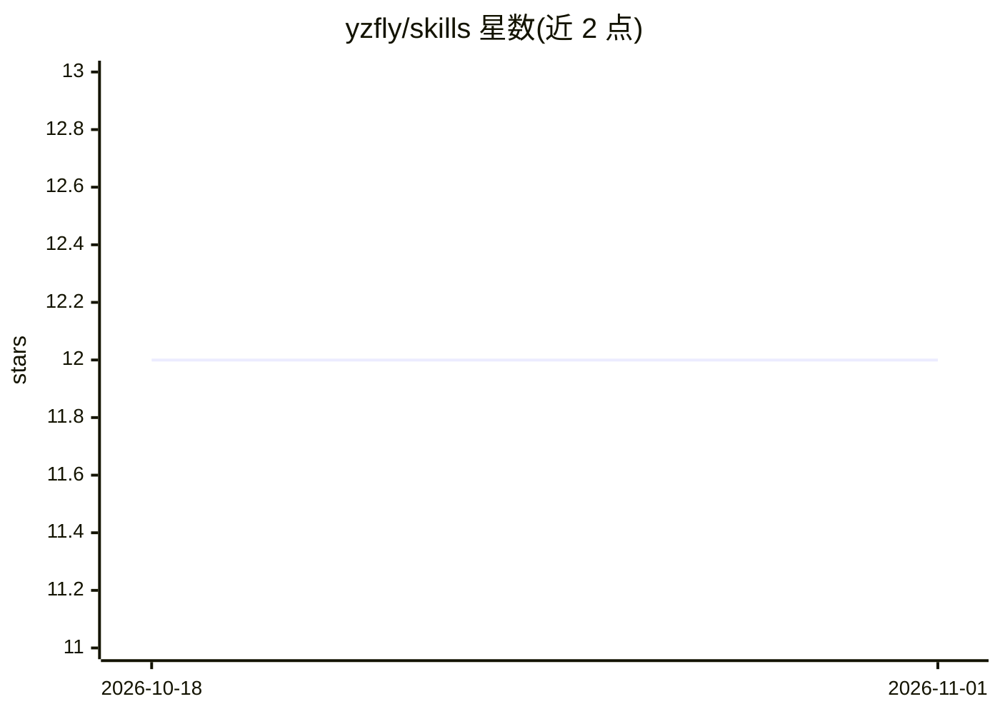

# yzfly/skills

⭐ 12 · Python · NOASSERTION · 推送 2026-09-26 · [GitHub](https://github.com/yzfly/skills) · 个人维护 · 中文 README

**Agent Skills 技能仓库：一行命令安装多种提示词技能**

云中江树（yzfly）维护的 AI Agent Skills 聚合仓库，收录 CTO 软件设计对话技能、品牌全案、品牌叙事、几何海报、公众号排版、像素图标、去 AI 味文案、王者荣耀出装参谋等技能，每个技能以 SKILL.md 加参考资料目录组织，许可按 skill 独立（CC BY-NC 4.0 或 MIT）。通过 npx skills add 一行命令安装，适配 Claude Code、OpenClaw、WorkBuddy、Cursor、Cline 等 17+ 种 Agent 工具，也支持 git clone 手动复制；另有 LangGPT、Awesome Design HTML 等技能在旗舰仓库维护、陆续收录。

## 筛选速览

| 维度 | 判定 | 备注 |
|---|---|---|
| AI 角色 | `ai-knowledge` | 知识聚合/清单类 |
| 许可风险 | `none` | NOASSERTION |
| 部署形态 | `library` | 以包/库形式分发 |
| 模型依赖 | — | README 未给出锁定关系 |
| 硬件要求 | — | 无带数字的原话,不猜 |
| 安装摩擦 | `low` | 无编译、无系统依赖或容器化 |
| 成熟度 | — | 结构信号不足 |

## 能力要点

- 8 个技能收录，各含 SKILL.md、README、独立 LICENSE 与按需加载的 references
- npx skills add 一行命令安装，适配 17+ 种 Agent 工具
- 提供 Claude Code 手动安装、OpenClaw ClawHub、WorkBuddy 对话安装三种途径
- 按 skill 双轨授权（CC BY-NC 4.0 / MIT），以目录内 LICENSE 为准

## 适用场景

- 给 Claude Code / Cursor 等 Agent 工具安装 CTO 软件设计对话技能
- 一场对话产出品牌全案、海报、公众号排版等设计产物
- 用结构化技能改进界面文案与提示词写作

## 场景标签

`提示工程` `精选清单` · 领域:Agent 开发

## 证据(README 行号)

> L5: **云中江树（yzfly）的 AI Agent Skills 统一仓库**
> L7: 一行命令安装，适配 Claude Code、OpenClaw、WorkBuddy、Cursor、Cline 等 17+ 种 Agent 工具
> L78:     SKILL.md        # 技能定义（frontmatter: name + description 触发条件）

## 星数曲线

2026-10-18 12 → 2026-11-01 12（+0）

---
*卡片 v1 · prompt 1.4 · 生成 2026-10-31 · 置信度 high · 依据 README sha `8550b43a4424` · [字段定义](../../DATASET.md)*
