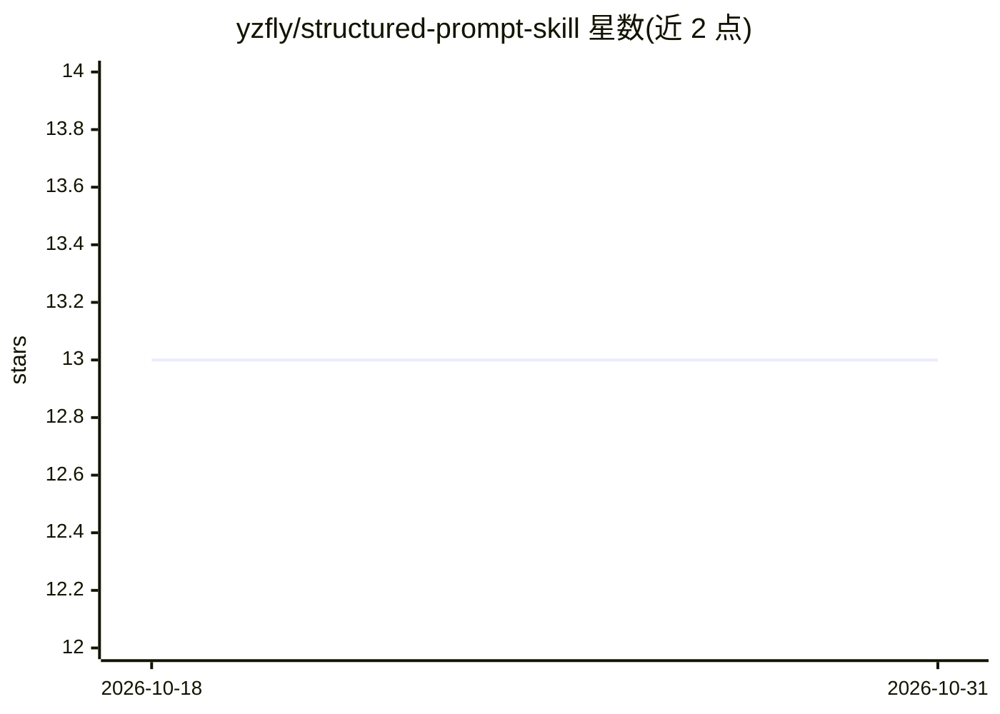

# yzfly/structured-prompt-skill

⭐ 13 · MIT · 推送 2026-01-11 · [GitHub](https://github.com/yzfly/structured-prompt-skill) · 个人维护 · 中文 README

**给提示词编写者的 Claude Code 技能与 300+ 提示词模板库**

包含两部分：一是可安装到 Claude Code 的 Structured Prompt Writer 技能，安装后为编写结构化提示词（persona/context/task/output format）提供指引，含中英文提示词模式；二是提示词参考库，收录来自 Anthropic、OpenAI、Google 及 Cursor、Cline 等开发工具与 AI 平台的系统提示词，中文人格提示词，以及 280+ GPT Store 泄露提示词。通过 cp 到 ~/.claude/skills/ 或 Claude Code 内 /skill import 安装。

## 筛选速览

| 维度 | 判定 | 备注 |
|---|---|---|
| AI 角色 | `ai-knowledge` | 知识聚合/清单类 |
| 许可风险 | `permissive` | MIT |
| 部署形态 | `None` |  |
| 模型依赖 | locked-api |  |
| 硬件要求 | — | 无带数字的原话,不猜 |
| 安装摩擦 | `low` | 无编译、无系统依赖或容器化 |
| 成熟度 | — | 结构信号不足 |

## 能力要点

- Claude Code 技能：结构化提示词编写指引（persona/context/task/output format）
- 收录 Anthropic/OpenAI/Google 等系统提示词参考
- 280+ GPT Store 提示词与中文人格提示词集合
- 支持中英文两种提示词格式模式

## 适用场景

- 在 Claude Code 中获得结构化提示词编写指导
- 查阅各 AI 工具的系统提示词写法作参考
- 复用现成人设与领域专家提示词模板

## 场景标签

`提示工程` · 领域:Agent 开发

## 证据(README 行号)

> L3: A comprehensive prompt engineering reference library and Claude Code skill for designing high-quality AI prompts.
> L10: 2. **Prompt Reference Library** - Curated collection of 300+ prompts from various AI tools and models
> L44: The reference library includes prompts from:

## 星数曲线

2026-10-18 13 → 2026-10-31 13（+0）

---
*卡片 v1 · prompt 1.4 · 生成 2026-10-31 · 置信度 high · 依据 README sha `9f03ab870761` · [字段定义](../../DATASET.md)*
