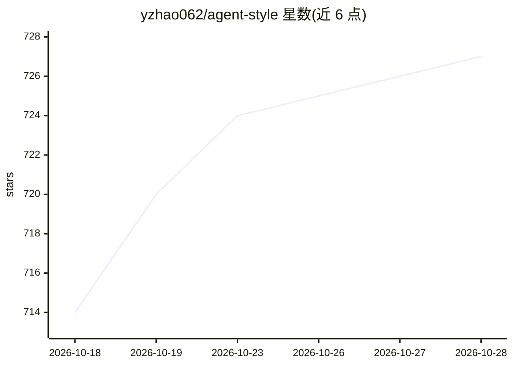

# yzhao062/agent-style

⭐ 728 · Python · 推送 2026-10-27 · [GitHub](https://github.com/yzhao062/agent-style) · 个人维护

**面向 AI 编程/写作 agent 的 21 条英文写作规则集，生成时加载**

一套格式化为 AI agent 系统提示/项目配置可读取的英文技术写作规则集：12 条提炼自 Strunk & White、Orwell、Pinker、Gopen & Swan 四部经典写作指南（逐条标注出处），9 条来自 2022-2026 年 LLM 输出的田野观察（含引用纪律 RULE-H），另含作者个人论文风格的 House Style 段。规则在生成时生效，非事后 linter；适用范围为 API 文档、设计文档、论文、README 等英文技术文体。通过 PyPI 与 npm 分发，可 drop-in 用于 Claude Code、Codex、Copilot、Cursor、Aider 等 agent。README 报告了 10 任务 × 2 生成的小型 sanity bench，机械违规数下降但明确标注无统计显著性，且两条 critical 规则未被测量。

## 筛选速览

| 维度 | 判定 | 备注 |
|---|---|---|
| AI 角色 | `ai-ecosystem` | LLM/agent 周边工具 |
| 许可风险 | `none` | — |
| 部署形态 | `library` | 以包/库形式分发 |
| 模型依赖 | — | README 未给出锁定关系 |
| 硬件要求 | — | 无带数字的原话,不猜 |
| 安装摩擦 | `low` | 无编译、无系统依赖或容器化 |
| 成熟度 | — | 结构信号不足 |

## 能力要点

- 21 条规则：12 条经典来源 + 9 条 LLM 特有失效模式，逐条给出出处
- 生成时加载（system prompt/项目配置），非事后检查
- 含可替换的个人 House Style 段，fork 后可换成自己的写作习惯
- v0.3.0/v0.4.2 sanity bench 报告机械 AI-tell 违规下降，附局限说明

## 适用场景

- 让我的 Claude Code / Codex / Cursor 生成更少 LLM 腔的技术文档
- 统一团队 agent 生成的 README、commit message 与设计文档风格
- 约束 agent 输出的引用纪律，减少无据断言

## 场景标签

`提示工程` `AI 写作` · 领域:Agent 开发

## 证据(README 行号)

> L26: A curated set of English writing rules formatted for AI coding and writing agents to follow **at generation time**,
> L114: - **AI coding and writing agents:** Claude Code, Codex, GitHub Copilot, Cursor, Aider, Anthropic Skills, Kiro, Rep
> L92: agent-style v0.3.0 sanity bench with corrected v0.4.2 scoring across Claude Opus 4.7, OpenAI GPT-5.4 via Codex CLI,

## 星数曲线

2026-10-18 714 → 2026-10-28 727（+13）

---
*卡片 v1 · prompt 1.4 · 生成 2026-10-22 · 置信度 high · 依据 README sha `487ebdc6e644` · [字段定义](../../DATASET.md)*
