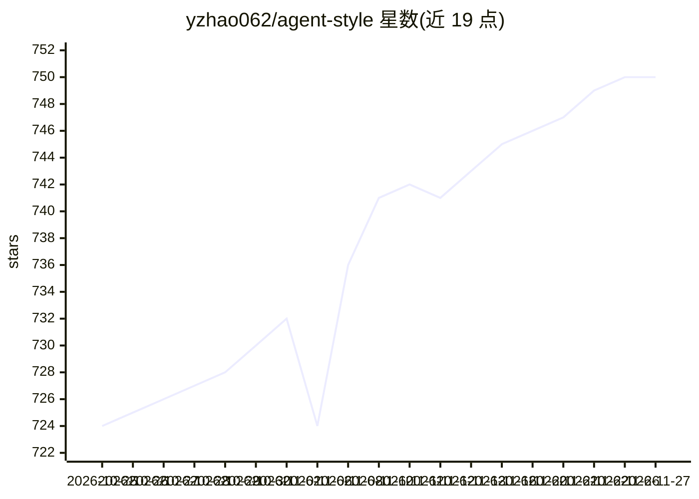

# yzhao062/agent-style

⭐ 750 · Python · 推送 2026-11-14 · [GitHub](https://github.com/yzhao062/agent-style) · 个人维护

**给 AI 编码/写作 agent 用的 21 条英文技术写作规则集**

一套按生成时注入格式编排的英文写作规则包，供 Claude Code、Codex、Copilot、Cursor、Aider 等 AI agent 在 system prompt 或项目配置中读取。21 条规则分两组：RULE-01..12 源自 Strunk & White、Orwell、Pinker、Gopen & Swan 等写作经典，RULE-A..I 为作者从 2022-2026 年 LLM 输出中记录的 field-observed 模式；另含可替换的 House Style 章节。通过 PyPI 与 npm 分发，自带 agent-style review 命令做违规检测。作者自述 bench 仅覆盖 7 条机械规则，两条 critical 语义规则未被度量。

## 筛选速览

| 维度 | 判定 | 备注 |
|---|---|---|
| AI 角色 | `ai-knowledge` | 知识聚合/清单类 |
| 许可风险 | `none` | — |
| 部署形态 | `library` | 以包/库形式分发 |
| 模型依赖 | — | README 未给出锁定关系 |
| 硬件要求 | — | 无带数字的原话,不猜 |
| 安装摩擦 | `low` | 无编译、无系统依赖或容器化 |
| 成熟度 | — | 结构信号不足 |

## 能力要点

- 21 条规则：12 条源自经典写作指南、9 条来自 LLM 输出观察，均标注出处
- House Style 章节可替换为用户自己的写作习惯（fork 定制）
- agent-style review --mechanical-only 提供规则违规检测
- 兼容 AGENTS.md 规范的工具均可读取

## 适用场景

- 让 coding agent 生成的 README/commit message 符合技术写作惯例
- 论文与基金申请草稿规避常见 LLM 写作模式
- fork 后用自己 AI 时代前的写作数据定制个人风格包

## 场景标签

`提示工程` · 领域:Agent 开发

## 证据(README 行号)

> L28: A curated set of English writing rules formatted for AI coding and writing agents to follow **at generation time**,
> L116: - **AI coding and writing agents:** Claude Code, Codex, GitHub Copilot, Cursor, Aider, Anthropic Skills, Kiro, Rep

## 星数曲线

2026-10-25 724 → 2026-11-27 750（+26）

---
*卡片 v1 · prompt 1.4 · 生成 2026-11-24 · 置信度 high · 依据 README sha `cc3bc7c92e7c` · [字段定义](../../DATASET.md)*
