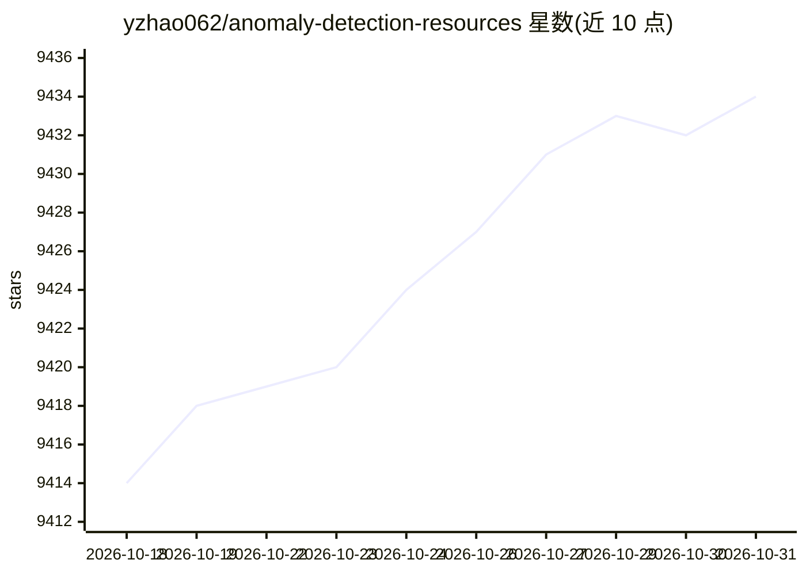

# yzhao062/anomaly-detection-resources

⭐ 9,434 · Python · AGPL-3.0 · 推送 2026-03-02 · [GitHub](https://github.com/yzhao062/anomaly-detection-resources) · 个人维护

**异常检测领域学习资源清单：书籍、论文、教程与工具箱聚合**

由 yzhao062（USC FORTIS Lab 相关）维护的异常检测/离群点检测学习资源聚合清单，收录书籍与学术论文、在线课程与视频、离群点数据集、开源与商业库/工具箱、关键会议与期刊五类条目。内容按多变量数据、时间序列、图离群检测等类别组织，论文部分含 22 个主题分类，其中包括 LLM 与 LLM Agent 用于异常检测的专题。条目通过 issue、PR 或邮件补充，不提供可安装的软件，仅作为阅读与查阅目录。

## 筛选速览

| 维度 | 判定 | 备注 |
|---|---|---|
| AI 角色 | `ai-knowledge` | 知识聚合/清单类 |
| 许可风险 | `viral` | AGPL-3.0 |
| 部署形态 | `None` |  |
| 模型依赖 | — | README 未给出锁定关系 |
| 硬件要求 | — | 无带数字的原话,不猜 |
| 安装摩擦 | `low` | 无编译、无系统依赖或容器化 |
| 成熟度 | — | 结构信号不足 |

## 能力要点

- 收录书籍、论文、课程、数据集、库与会议五类资源
- 论文部分含 22 个主题分类，含 LLM/LLM Agent 异常检测专题
- 提供 NLP-ADBench 与 AD-LLM 等 LLM 异常检测基准工作索引
- 维护者关联 PyOD 库与 ADBench 基准

## 适用场景

- 系统学习异常检测领域的教材、教程与课程
- 查找特定方向（时间序列、图、弱监督等）的论文与基准
- 寻找可用的开源检测工具箱与数据集

## 场景标签

`精选清单` · 领域:学习与行业

## 证据(README 行号)

> L29: **This repository collects**:
> L65:  * `4.1. LLM and LLM Agents for Anomaly Detection <#41-llm-and-llm-agents-for-anomaly-detection>`_

## 星数曲线

2026-10-18 9,414 → 2026-10-31 9,434（+20）

---
*卡片 v1 · prompt 1.4 · 生成 2026-10-20 · 置信度 high · 依据 README sha `8f42606dc85c` · [字段定义](../../DATASET.md)*
