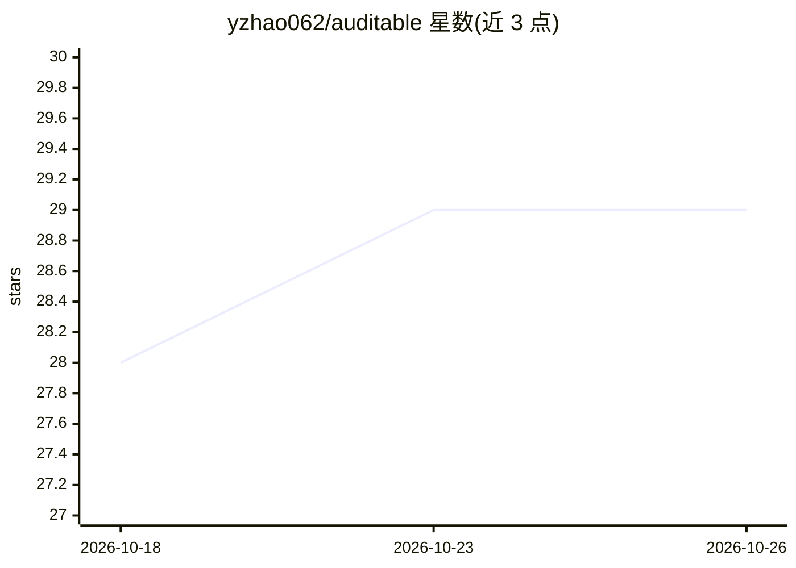

# yzhao062/auditable

⭐ 29 · Python · Apache-2.0 · 推送 2026-10-25 · [GitHub](https://github.com/yzhao062/auditable) · [官网](https://auditable-ai.readthedocs.io/) · 个人维护

**AI agent 决策审计方法库：运行前/中/后三阶段统一接口**

Python 库，收集在三个时点审计 LLM agent 的方法：运行前的配置审计（PRE）、运行中的在线监控（LIVE）、运行后的失败检测与错误步骤定位（POST）。方法分为 Config/Online/Run/Step 四族，每族一个接口，仿照 PyOD 的组织方式；收录 PyOD/PyGOD 检测器、GUARDIAN、G-Safeguard、Who&When LLM-judge 协议等基线及 GRADE 与 CatchBench 引入的方法。通过 agentpile 读取公开 agent 轨迹数据集与多种轨迹文件格式（OpenAI 消息、OTLP JSON、Claude Code 会话、MCP 工具列表），LLM judge 后端接受任意 prompt->reply 函数。限制：含子 agent 轨迹的运行不展平，需逐个读取或跳过；图方法需另行安装 torch 与 pyg-lib。

## 筛选速览

| 维度 | 判定 | 备注 |
|---|---|---|
| AI 角色 | `ai-ecosystem` | LLM/agent 周边工具 |
| 许可风险 | `permissive` | Apache-2.0 |
| 部署形态 | `library` | 以包/库形式分发 |
| 模型依赖 | — | README 未给出锁定关系 |
| 硬件要求 | — | 无带数字的原话,不猜 |
| 安装摩擦 | `low` | 无编译、无系统依赖或容器化 |
| 成熟度 | — | 结构信号不足 |

## 能力要点

- PRE/LIVE/POST 三时点四族方法，每族统一接口，get_method(id) 一行切换
- 收录 PyOD/PyGOD 检测器、GUARDIAN、G-Safeguard、Who&When LLM judge 等文献基线
- agentpile 转换公开数据集（Who&When、tau-bench、SWE-Gym 等）与多种轨迹文件格式
- 出现在 CatchBench 榜单的方法逐样本复现其结果

## 适用场景

- agent 上线前审计配置是否权限过度
- 运行中按步骤输出告警分数拦截失败
- 运行后判定是否失败并定位决定性错误步骤
- 复现 CatchBench/GRADE 基准结果做方法对比

## 场景标签

 · 领域:LLM 基础设施/agent 可观测性

## 证据(README 行号)

> L5: **A library of auditing methods for AI agents: configuration audits before a run, online monitors while it runs, and
> L14: `auditable` collects methods that audit LLM agents at three points: an agent configuration before it runs (PRE), a 
> L62: Configuration rules and the step-by-step and binary-search LLM judges run on the core install, graph detectors need

## 星数曲线

2026-10-18 28 → 2026-10-26 29（+1）

---
*卡片 v1 · prompt 1.4 · 生成 2026-10-26 · 置信度 high · 依据 README sha `95fc739bdec2` · [字段定义](../../DATASET.md)*
