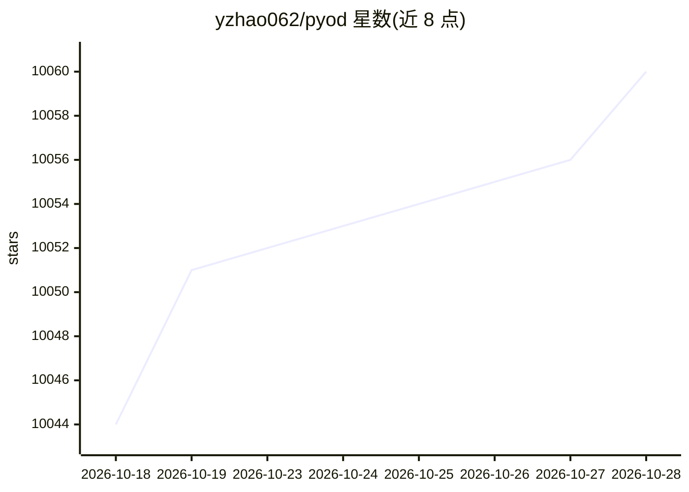

# yzhao062/pyod

⭐ 10,060 · Python · BSD-2-Clause · 推送 2026-10-12 · [GitHub](https://github.com/yzhao062/pyod) · [官网](https://pyod.dev/) · 个人维护

**面向开发者的多模态异常检测 Python 库，60+ 检测器统一 API**

Python 异常/离群检测库，覆盖表格、时间序列、图、文本、图像、音频六类数据，提供 61 个检测器与统一 API（经典 fit/predict 不变）。V3 增加 ADEngine 生命周期编排层（自动选择、比较、评估检测器）与 agentic 层：为 Claude Code/Codex 提供 od-expert 技能，为 MCP 兼容 LLM 暴露 10 个无状态工具（检索器查询、规划、检测执行）。基于 SUOD 并行训练与 numba JIT 加速。以 pip 包形式安装，支持 conda 与源码安装。

## 筛选速览

| 维度 | 判定 | 备注 |
|---|---|---|
| AI 角色 | `ai-native` | 本体是模型或模型工具 |
| 许可风险 | `permissive` | BSD-2-Clause |
| 部署形态 | `library` | 以包/库形式分发 |
| 模型依赖 | locked-api |  |
| 硬件要求 | — | 无带数字的原话,不猜 |
| 安装摩擦 | `low` | 无编译、无系统依赖或容器化 |
| 成熟度 | — | 结构信号不足 |

## 能力要点

- 61 个检测器覆盖表格/时序/图/文本/图像/音频，统一 API
- ADEngine 单次调用完成从原始数据到可解释异常结果的编排
- od-expert 技能接入 Claude Code/Codex，MCP 服务器暴露 10 个工具
- 基准支撑的检测器路由（ADBench、TSB-AD、BOND、NLP-ADBench）

## 适用场景

- 在表格/时序/图等数据上直接做离群点检测与评分
- 让 PyOD 自动选择并比较合适检测器，无需手工调参
- 通过自然语言对话让 AI agent 驱动完整检测流程
- 欺诈检测、工业监控等场景的异常评分

## 场景标签

 · 领域:机器学习/异常检测

## 证据(README 行号)

> L67: Multi-Modal 61 detectors across **tabular, time series, graph, text, image, and audio** data, one API
> L111:  from pyod.models.iforest import IForest

## 星数曲线

2026-10-18 10,044 → 2026-10-28 10,060（+16）

---
*卡片 v1 · prompt 1.4 · 生成 2026-10-20 · 置信度 high · 依据 README sha `ee4d7209ecfb` · [字段定义](../../DATASET.md)*
