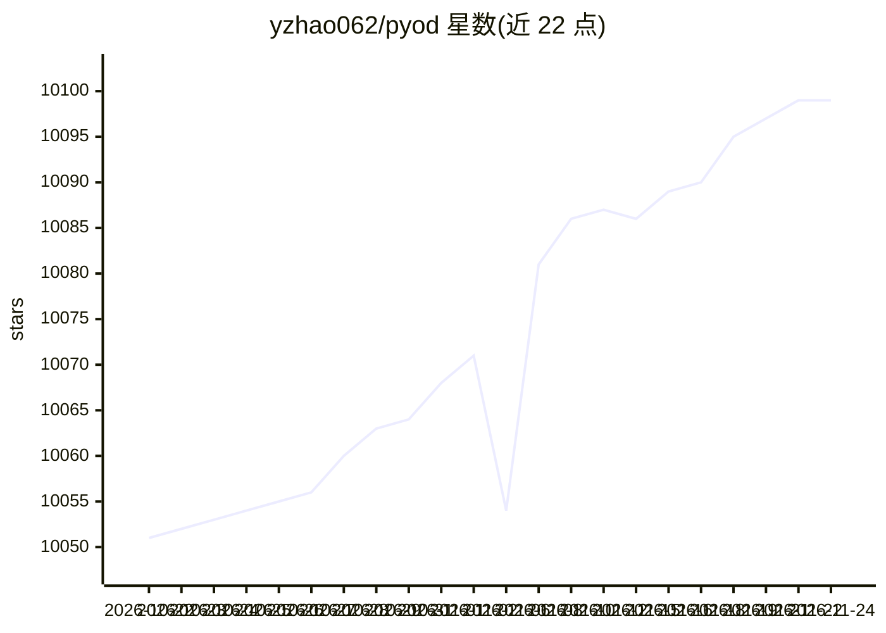

# yzhao062/pyod

⭐ 10,099 · Python · BSD-2-Clause · 推送 2026-11-22 · [GitHub](https://github.com/yzhao062/pyod) · [官网](https://pyod.dev/) · 组织维护

**给数据科学家的多模态异常检测 Python 库，60+ 检测器与 Agent 工作流**

Python 异常检测库 PyOD，覆盖表格、时间序列、图、文本、图像、音频六类数据，提供 61 个检测器与统一的 fit/predict API。三层使用方式：直接调用检测器、ADEngine 自动选择与评估、通过 od-expert 技能或 MCP 服务器驱动 AI agent 以自然语言执行检测流程。安装通过 pip/conda，MCP 为可选扩展；经典 API 向后兼容，V3 基于 SUOD 并行训练与 numba JIT。

## 筛选速览

| 维度 | 判定 | 备注 |
|---|---|---|
| AI 角色 | `ai-native` | 本体是模型或模型工具 |
| 许可风险 | `permissive` | BSD-2-Clause |
| 部署形态 | `library` | 以包/库形式分发 |
| 模型依赖 | locked-api |  |
| 硬件要求 | — | 无带数字的原话,不猜 |
| 安装摩擦 | `low` | 无编译、无系统依赖或容器化 |
| 成熟度 | `idea` | |

## 能力要点

- 61 个检测器覆盖表格、时间序列、图、文本、图像、音频数据，统一 API
- od-expert 技能将自然语言请求转为 ADEngine 检测工作流（Claude Code/Codex）
- MCP 服务器暴露 10 个无状态工具：知识查询、规划与检测执行
- 基准驱动的检测器路由（ADBench、TSB-AD、BOND、NLP-ADBench）

## 适用场景

- 对表格或时序数据批量训练异常检测模型
- 让 AI agent 通过对话完成从数据画像到异常解释的检测流程
- 为学术研究或企业风控（欺诈检测）引入带基准支撑的检测器

## 场景标签

`数据分析` · 领域:效率与自动化

## 证据(README 行号)

> L62: PyOD 3 is the most comprehensive Python library for anomaly detection. Four pillars:
> L67: Multi-Modal 61 detectors across **tabular, time series, graph, text, image, and audio** data, one API
> L116: **Outlier Detection with 5 Lines of Code** (``pip install pyod``):

## 星数曲线

2026-10-22 10,051 → 2026-11-24 10,099（+48）

---
*卡片 v1 · prompt 1.4 · 生成 2026-11-23 · 置信度 high · 依据 README sha `85a2eab6c2cb` · [字段定义](../../DATASET.md)*
