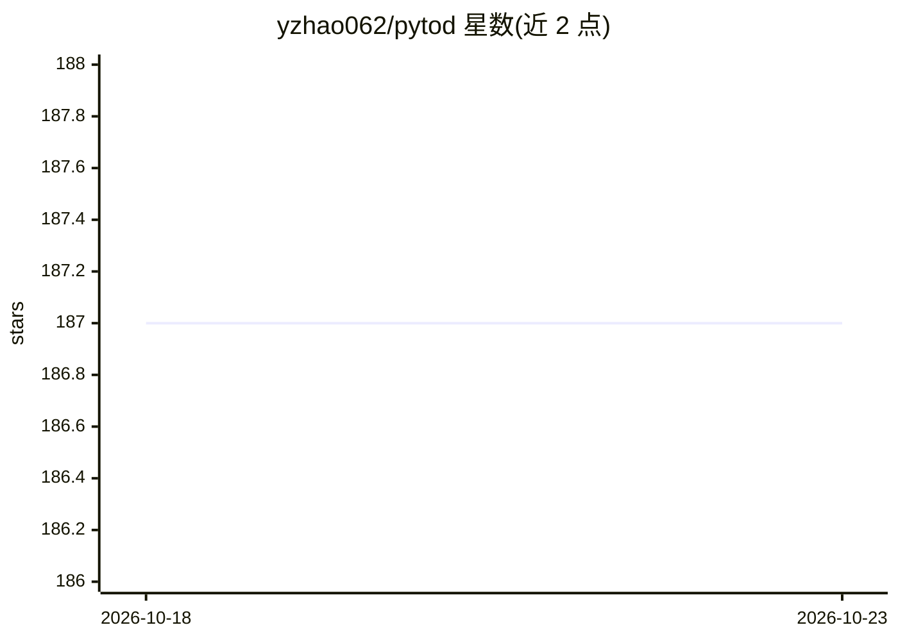

# yzhao062/pytod

⭐ 187 · Python · BSD-2-Clause · 推送 2026-09-08 · [GitHub](https://github.com/yzhao062/pytod) · [官网](https://arxiv.org/abs/2110.14007) · 个人维护

**给数据分析开发者的 GPU 加速离群点检测 Python 库**

PyTOD 将离群点检测算法分解为基础张量代数运算以实现 GPU 加速，支持分布式多 GPU 环境，宣称可在一小时内处理超百万样本的检测任务。实现 PCA、LOF、COPOD、kNN 等十余种无监督离群点检测算法，提供可量化和自动批处理技术；无 GPU 时可回退 CPU 运行。以 pip 包形式安装，依赖 torch>=1.7。README 自述文档与代码仍在建设与清理中。

## 筛选速览

| 维度 | 判定 | 备注 |
|---|---|---|
| AI 角色 | `ai-native` | 本体是模型或模型工具 |
| 许可风险 | `permissive` | BSD-2-Clause |
| 部署形态 | `library` | 以包/库形式分发 |
| 模型依赖 | — | README 未给出锁定关系 |
| 硬件要求 | — | 无带数字的原话,不猜 |
| 安装摩擦 | `low` | 无编译、无系统依赖或容器化 |
| 成熟度 | `idea` | |

## 能力要点

- 将 OD 算法分解为张量代数运算以做 GPU 加速
- 支持多 GPU 与分布式环境，无 GPU 可回退 CPU
- 实现 LOF/COPOD/kNN/ABOD 等 10 种以上检测算法
- 提供论文可复现脚本与 ODDS 基准数据集

## 适用场景

- 在大规模数据上快速跑离群点检测（如欺诈/入侵检测前的筛查）
- 有 GPU 的机器上加速 LOF/kNN 等传统 OD 算法
- 复现 TOD 论文的对比实验

## 场景标签

 · 领域:机器学习/异常检测

## 证据(README 行号)

> L57:  from pytod.models.knn import KNN
> L63:  y_test_scores = clf.decision_function(X_test) # predict raw outlier scores on test

## 星数曲线

2026-10-18 187 → 2026-10-23 187（+0）

---
*卡片 v1 · prompt 1.4 · 生成 2026-10-22 · 置信度 high · 依据 README sha `15a410e0083f` · [字段定义](../../DATASET.md)*
