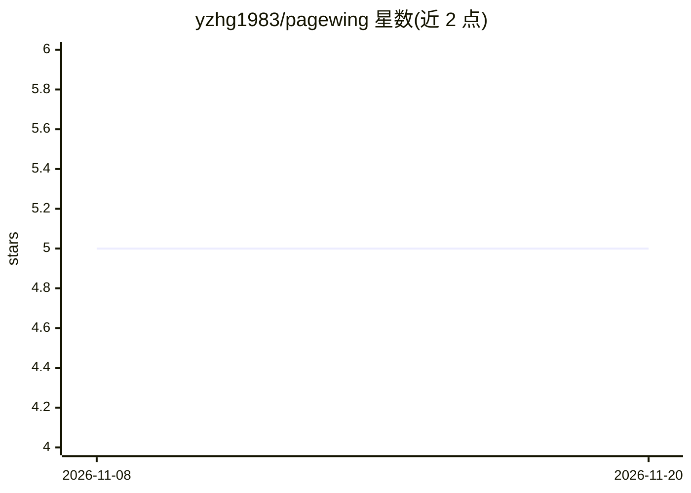

# yzhg1983/pagewing

⭐ 5 · TypeScript · MIT · 推送 2026-11-19 · [GitHub](https://github.com/yzhg1983/pagewing) · 个人维护 · 中文 README

**Chrome 侧边栏 AI 代理：读取并操作当前页面，直接用你的密钥**

运行于 Chrome 侧边栏的通用 AI 代理：读取当前页面、点击与输入、跨页面与标签组移动，点击不够时自己编写并运行脚本，每一步在聊天中可见。基于 pi-durable 持久代理运行时构建，任务可在切换标签或后台被停后继续。不设自有服务器，请求从浏览器直连模型提供方，支持 ChatGPT 订阅或四种 API 密钥。通过工具开关与 Ask 模式控制权限，默认不触碰密码与支付字段。MIT 开源，无分析埋点。

## 筛选速览

| 维度 | 判定 | 备注 |
|---|---|---|
| AI 角色 | `ai-native` | 本体是模型或模型工具 |
| 许可风险 | `permissive` | MIT |
| 部署形态 | `desktop` | 安装包/桌面程序 |
| 模型依赖 | locked-api |  |
| 硬件要求 | — | 无带数字的原话,不猜 |
| 安装摩擦 | `low` | 无编译、无系统依赖或容器化 |
| 成熟度 | `idea` | |

## 能力要点

- 读取页面、点击输入、运行脚本、截图等少量通用工具构成完整代理能力
- 基于 pi-durable：每步即时保存，任务跨标签切换与后台中断后延续
- 无自有服务器，请求从浏览器直连提供方，每聊天实时显示成本
- 工具级开关与 Ask 确认：动作与脚本默认先询问
- 可经 MCP 暴露页面工具给本地编码代理

## 适用场景

- 让代理总结、翻译、校对当前页面或选中文本
- 跨多个标签比较商品参数并生成表格
- 让代理自动填写表单、收集长表格数据
- 把页面读取与操作能力接入本地编码代理

## 场景标签

`浏览器自动化` `AI 助手` · 领域:效率与自动化

## 证据(README 行号)

> L7: **An AI agent in Chrome's side panel.** Ask about the page you are on, or hand pi a task: it reads the page, clicks 
> L12: **Use your ChatGPT plan**, or your own OpenAI, Anthropic, OpenRouter, or DeepSeek API key. There is no Pagewing ser
> L15: Pagewing is an experimental project built on pi-durable.

## 星数曲线

2026-11-08 5 → 2026-11-20 5（+0）

---
*卡片 v1 · prompt 1.4 · 生成 2026-11-20 · 置信度 mid · 依据 README sha `21098547a027` · [字段定义](../../DATASET.md)*
