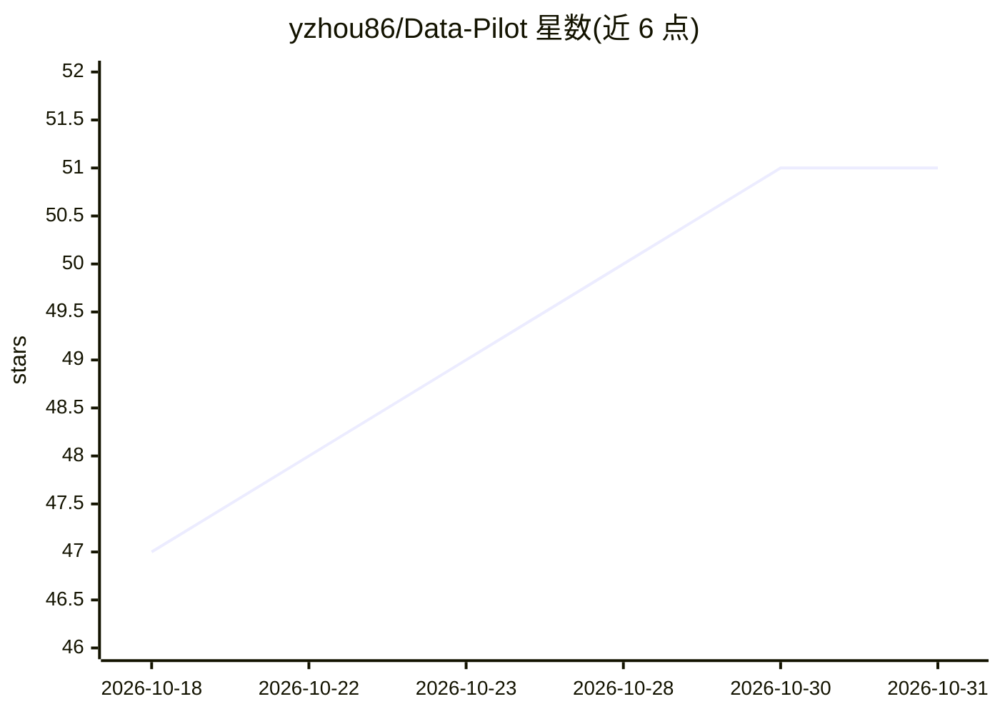

# yzhou86/Data-Pilot

⭐ 51 · Python · 推送 2026-05-11 · [GitHub](https://github.com/yzhou86/Data-Pilot) · 个人维护 · 中文 README

**面向学生与科研者的数据分析 AI Agent：LLM 驱动 ML 分析**

AI 优先的数据与研究工作台（原名 DataPilot，README 标为 SciPilot）：上传 CSV/Excel 或选择内置数据集，勾选分析工具（数据画像、相关性、孤立森林异常检测、KMeans 聚类、TF-IDF 文本聚类、时序预测、基线分类），配合自然语言提示让 agent 分析数据。架构为 Vue 3 聊天式前端 + 统一 Flask 后端，用户/LLM 配置存于本地 SQLite。后端支持 Qwen/DashScope 与 OpenAI 兼容两种 API 风格；无有效 LLM 时仍执行本地确定性分析。支持中英文界面切换、Docker 部署与三平台启动脚本。

## 筛选速览

| 维度 | 判定 | 备注 |
|---|---|---|
| AI 角色 | `ai-native` | 本体是模型或模型工具 |
| 许可风险 | `none` | — |
| 部署形态 | `self-host` | docker 或自建部署 |
| 模型依赖 | — | README 未给出锁定关系 |
| 硬件要求 | — | 无带数字的原话,不猜 |
| 安装摩擦 | `low` | 无编译、无系统依赖或容器化 |
| 成熟度 | `idea` | |

## 能力要点

- CSV/Excel 上传后由 agent 运行 7 类 ML/AI 分析工具
- Qwen/DashScope 与 OpenAI 兼容 API 双通道，LLM 配置由管理员存于 SQLite
- 无 LLM key 时退回本地确定性分析
- 登录/会话控制、用户管理与聊天记录导出 PDF，界面支持中英文

## 适用场景

- 上传课程或实验数据集，用自然语言提问获得分析结果
- 在无外部 API key 的环境跑本地数据画像与聚类
- 实验室内部署，管理员统一配置 LLM 后多用户使用

## 场景标签

`数据分析` `科研工具` · 领域:效率与自动化

## 证据(README 行号)

> L21: Upload a CSV or Excel file, or choose one of the built-in example datasets in the UI, then select the ML/AI tools y
> L27: - Qwen / DashScope

## 星数曲线

2026-10-18 47 → 2026-10-31 51（+4）

---
*卡片 v1 · prompt 1.4 · 生成 2026-10-24 · 置信度 high · 依据 README sha `4c812412d33f` · [字段定义](../../DATASET.md)*
