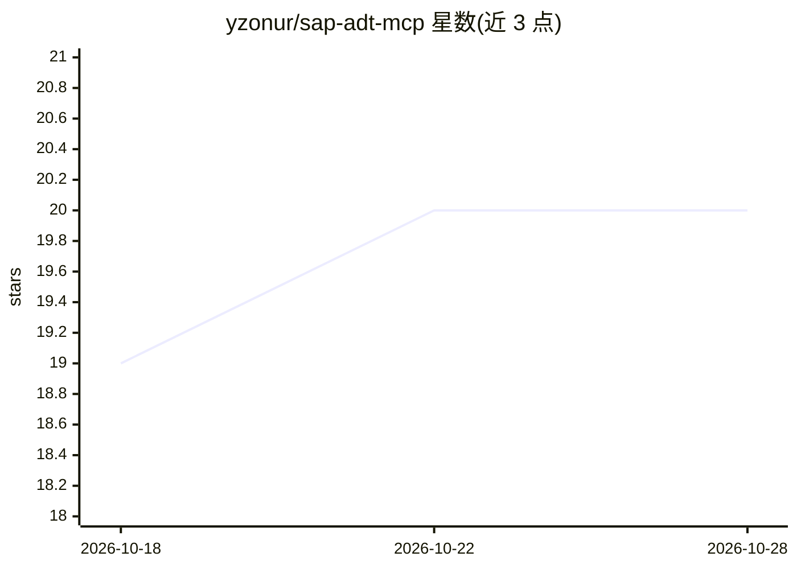

# yzonur/sap-adt-mcp

⭐ 20 · JavaScript · MIT · 推送 2026-10-09 · [GitHub](https://github.com/yzonur/sap-adt-mcp) · [官网](https://github.com/yzonur/claude-for-abap) · 个人维护

**MCP 服务器：让 Claude 等 AI 客户端经 ADT 直接操作 SAP 系统**

Node.js 实现的 MCP server，封装 50 余个 ADT HTTP API 工具，供 Claude 及任意 MCP 兼容客户端读取/编辑/激活 ABAP 源码、运行语法检查/ABAP Unit/ATC、跨系统对比对象、管理传输请求、调试与查看 dump 等，SAP 侧无需安装附加组件。支持多系统配置（DEV/QAS/PRD）、全局或按系统的 readOnly 拦截、写操作 JSONL 审计日志、60 秒结果缓存，默认开启经脱敏的自动错误上报（可关闭）。要求 Node.js 22.19+，部分实验性工具仅在 S/4HANA 等系统可用。

## 筛选速览

| 维度 | 判定 | 备注 |
|---|---|---|
| AI 角色 | `ai-ecosystem` | LLM/agent 周边工具 |
| 许可风险 | `permissive` | MIT |
| 部署形态 | `library` | 以包/库形式分发 |
| 模型依赖 | — | README 未给出锁定关系 |
| 硬件要求 | — | 无带数字的原话,不猜 |
| 安装摩擦 | `low` | 无编译、无系统依赖或容器化 |
| 成熟度 | — | 结构信号不足 |

## 能力要点

- 50+ ADT 工具覆盖源码 CRUD、质量检查、传输、调试、跨系统 diff
- readOnly 标志拦截全部写方法，写操作记录本地 JSONL 审计日志
- 一套配置管理多个 SAP 系统，支持跨系统源码与传输对比
- 5 个 Clean Core 提示将工具面转为斜杠命令

## 适用场景

- ABAP 开发者用 Claude 会话读取、修改、激活代码并跑检查
- AI agent 在 DEV 可写、QAS/PRD 只读的安全策略下做 SAP 运维
- 跨 DEV/QAS/PRD 对比同一对象源码差异
- 审计 AI 对 SAP 做过的每一笔写操作

## 场景标签

`编码 Agent` · 领域:编码与开发

## 证据(README 行号)

> L3: > **MCP server giving Claude (and any MCP-compatible client) live access to SAP systems via ADT.**
> L27: **50+ high-level tools** wrapped around the most common ADT endpoints, plus a
> L83: Requires Node.js **22.19+** (undici v8, used as the HTTP client, requires

## 星数曲线

2026-10-18 19 → 2026-10-28 20（+1）

---
*卡片 v1 · prompt 1.4 · 生成 2026-10-28 · 置信度 high · 依据 README sha `5451251aeaae` · [字段定义](../../DATASET.md)*
