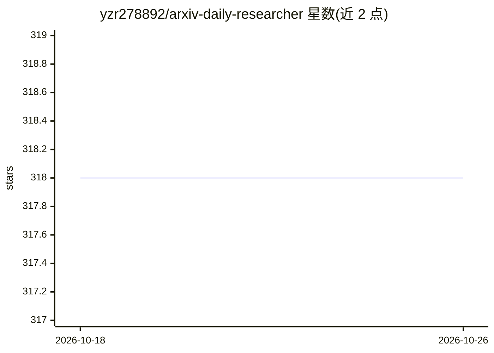

# yzr278892/arxiv-daily-researcher

⭐ 318 · Python · AGPL-3.0 · 推送 2026-10-20 · [GitHub](https://github.com/yzr278892/arxiv-daily-researcher) · 个人维护 · 中文 README

**面向科研人员的 arXiv 论文追踪与中文摘要报告生成工具**

定期检索 arXiv、PRL/PRB、Nature、Science、Hugging Face Papers 与自定义 OpenAlex 期刊来源，按关键词和个人偏好对论文评分筛选，用 OpenAI 兼容模型服务生成中文摘要、TL;DR、PDF 分析及 Markdown/HTML 报告，并可发送到邮件、企业微信、钉钉、Telegram、Slack 等渠道。提供 WebUI 完成配置、运行与阅读，支持 Docker Compose 部署（linux/amd64 与 arm64 镜像）、命令行入口及 GitHub Actions 工作流。限制：需自备 OpenAI 兼容模型 API；仅建议在可信局域网或配置 HTTPS 反代后使用。

## 筛选速览

| 维度 | 判定 | 备注 |
|---|---|---|
| AI 角色 | `ai-native` | 本体是模型或模型工具 |
| 许可风险 | `viral` | AGPL-3.0 |
| 部署形态 | `self-host` | docker 或自建部署 |
| 模型依赖 | — | README 未给出锁定关系 |
| 硬件要求 | — | 无带数字的原话,不猜 |
| 安装摩擦 | `low` | 无编译、无系统依赖或容器化 |
| 成熟度 | — | 结构信号不足 |

## 能力要点

- 四种论文评分策略（核心相关性/加权关键词/加权关键词＋扣分/偏好学习）
- 多来源检索并跨来源关联同一论文
- 中文摘要、PDF 方法/结论/局限分析与关键词趋势报告
- 邮件/企业微信/钉钉/Telegram/Slack/Webhook 通知与 WebDAV 同步备份

## 适用场景

- 每天自动获取符合研究兴趣的论文中文摘要报告
- 围绕主题和时间段做文献趋势分析
- 将合格论文自动收藏并归档历史报告

## 场景标签

`科研工具` · 领域:学习与行业

## 证据(README 行号)

> L17: ArXiv Daily Researcher 定期检索 arXiv 与可选期刊来源，根据关键词和个人偏好筛选论文，生成中文摘要、PDF 分析及 Markdown / HTML 报告。通过浏览器完成配置、运行和阅读，也可将结果发送到
> L35: 生成摘要译文、简短 TL;DR 和关键词；通过筛选后可继续分析 PDF 的方法、结论和局限。支持 PyMuPDF 本地解析、MinerU 服务，以及可关闭的 Semantic Scholar TL;DR 翻译。

## 星数曲线

2026-10-18 318 → 2026-10-26 318（+0）

---
*卡片 v1 · prompt 1.4 · 生成 2026-10-23 · 置信度 high · 依据 README sha `d3536de96048` · [字段定义](../../DATASET.md)*
