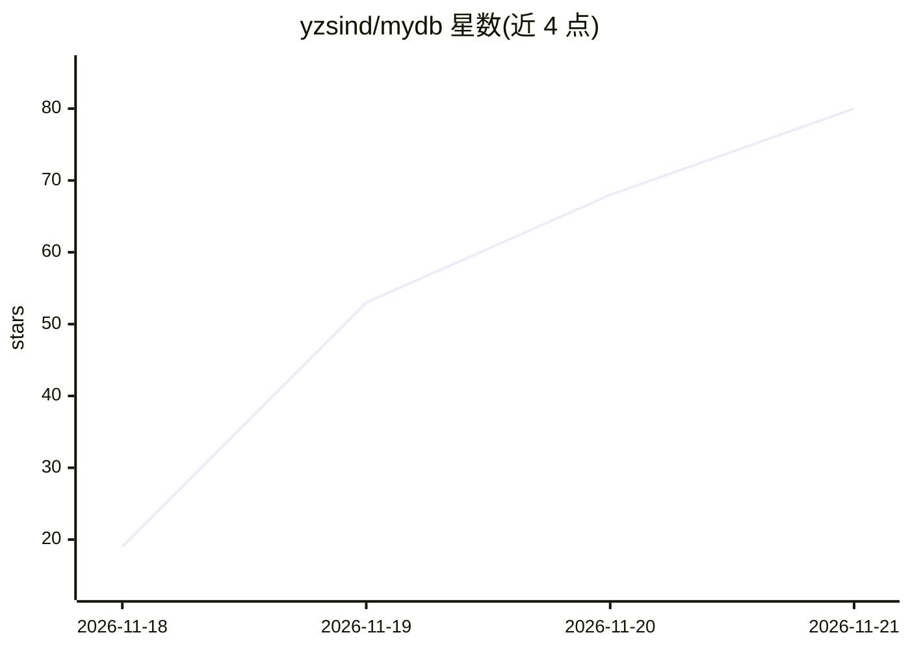

# yzsind/mydb

⭐ 80 · Rust · Apache-2.0 · 推送 2026-11-20 · [GitHub](https://github.com/yzsind/mydb) · 个人维护

**Rust 编写的 MySQL 兼容 HTAP 数据库，内置向量检索与 AI 调用**

用 Rust 实现的通用数据库，面向混合事务/分析（HTAP）工作负载，兼容 MySQL 协议、客户端与 ROW/FULL binlog。内置全文与向量检索（HNSW/IVF）、自动 Zone Maps、在线 schema 变更、可查询备份。面向 AI agent 提供 SQL 级模型调用（AI_GENERATE/AI_EMBED，支持 Ollama、OpenAI 等本地/远程服务）、REST SQL 与 MCP Server 接口。提供预编译二进制（macOS/Linux/Windows）、Docker 镜像与源码构建三种方式。README 声明 1.0.0 为 public-preview 发布，用于功能验证与受控环境评估。

## 筛选速览

| 维度 | 判定 | 备注 |
|---|---|---|
| AI 角色 | `ai-ecosystem` | LLM/agent 周边工具 |
| 许可风险 | `permissive` | Apache-2.0 |
| 部署形态 | `desktop` | 安装包/桌面程序 |
| 模型依赖 | local-ok | 支持本地模型 |
| 硬件要求 | — | 无带数字的原话,不猜 |
| 安装摩擦 | `low` | 无编译、无系统依赖或容器化 |
| 成熟度 | `idea` | |

## 能力要点

- 单引擎承载事务读写与分析查询（HTAP），含并行执行与向量化
- SQL 内 AI_GENERATE/AI_EMBED 调用本地或远程模型，支持 JSON Schema 结构化输出
- 原生全文+向量混合检索，HNSW 与 IVF 索引
- MySQL 客户端/驱动复用，另提供 REST SQL 与 MCP Server 接口

## 适用场景

- 用现有 MySQL 客户端和驱动直接接入，替换或新增事务+分析混合负载数据库
- AI agent 通过 MCP/REST 读写业务数据并做 RAG 检索与持久记忆
- 在 SQL 内直接调用 LLM 生成摘要、抽取或嵌入向量并 join 回业务表

## 场景标签

`向量数据库` · 领域:知识与检索

## 证据(README 行号)

> L11: MyDB is a general-purpose database built in Rust for **HTAP (hybrid
> L238: - **Local and remote services**: configure SQL connection and model objects for Ollama, OpenAI Responses, Chat Com

## 星数曲线

2026-11-18 19 → 2026-11-21 80（+61）

---
*卡片 v1 · prompt 1.4 · 生成 2026-11-18 · 置信度 high · 依据 README sha `049d6b3a3c6b` · [字段定义](../../DATASET.md)*
