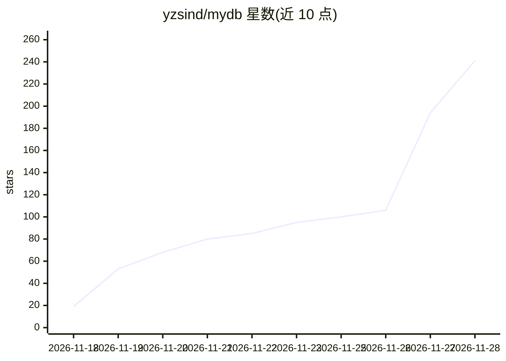

# yzsind/mydb

⭐ 241 · Rust · Apache-2.0 · 推送 2026-11-27 · [GitHub](https://github.com/yzsind/mydb) · 个人维护 · 中文 README

**面向 HTAP 与 AI agent 的 MySQL 兼容数据库**

用 Rust 编写的通用数据库，定位 HTAP（同一数据集上的事务与分析混合负载）并兼容 MySQL 客户端、JDBC 驱动与 binlog。内置全文与向量检索（HNSW/IVF）、自动 Zone Maps、在线 DDL、可查询备份，并提供 REST SQL 与 MCP 接口供 agent 访问；SQL 中可通过 AI_GENERATE/AI_EMBED 调用外部模型生成文本与嵌入。1.0.3 为 public-preview 版本，供功能验证与受控环境评估，预编译包覆盖 macOS/Linux/Windows，亦可从源码或 Docker 运行。

## 筛选速览

| 维度 | 判定 | 备注 |
|---|---|---|
| AI 角色 | `ai-enhanced` | 去掉 AI 部分产品仍成立 |
| 许可风险 | `permissive` | Apache-2.0 |
| 部署形态 | `desktop` | 安装包/桌面程序 |
| 模型依赖 | local-ok | 支持本地模型 |
| 硬件要求 | — | 无带数字的原话,不猜 |
| 安装摩擦 | `low` | 无编译、无系统依赖或容器化 |
| 成熟度 | `idea` | |

## 能力要点

- 原生向量与混合检索，SQL 内调用外部模型（AI_GENERATE/AI_EMBED）
- 兼容 MySQL 客户端、JDBC 驱动与 ROW/FULL binlog 集成
- 自动 Zone Maps 免手工索引，支持在线 schema 变更与可查询备份
- 提供 REST SQL API 与 MCP Server，agent 可直接执行参数化 SQL

## 适用场景

- 同一业务数据上混合运行事务读写与分析查询
- 为 AI agent 提供带向量检索和持久记忆的数据库
- 复用现有 MySQL 客户端和驱动接入新数据库
- 通过 MCP 让 agent 探查 schema 并执行参数化 SQL

## 场景标签

`向量数据库` · 领域:知识与检索

## 证据(README 行号)

> L13: MyDB is a general-purpose database built in Rust for **HTAP (hybrid
> L257: ## Built for AI Agents
> L259: An agent's data needs change with every task: add a column, build an index, write embeddings, then join retrieval 

## 星数曲线

2026-11-18 19 → 2026-11-28 241（+222）

---
*卡片 v1 · prompt 1.4 · 生成 2026-11-27 · 置信度 high · 依据 README sha `0d4e0288c4a8` · [字段定义](../../DATASET.md)*
