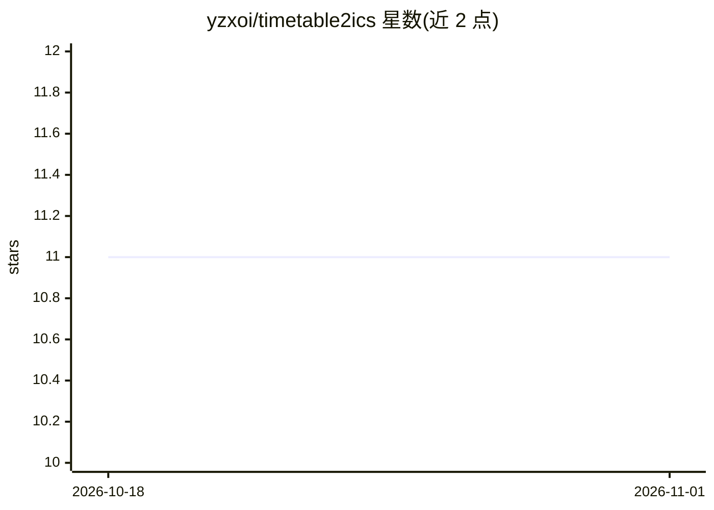

# yzxoi/timetable2ics

⭐ 11 · Python · 推送 2026-09-21 · [GitHub](https://github.com/yzxoi/timetable2ics) · [官网](https://timetable2ics.streamlit.app) · 个人维护 · 中文 README

**用 LLM 把教务课表文本转成 .ics 日历文件的网页工具**

面向大学生的 Streamlit 网页应用：粘贴教务系统导出的原始课表文本，由 LLM 解析为结构化课程数据，支持自定义每节课开始时间、课时长度与学期起始日，表格预览确认后生成可导入 Apple/Google/Outlook 的 .ics 文件。可自带 LLM API Key（如阿里云 DashScope），未填时使用平台公用 Key 并弹出赞赏码，公用 Key 仅供体验。本地以 pip 安装依赖后通过 streamlit run 启动，另提供 iPhone 快捷指令导入方案。

## 筛选速览

| 维度 | 判定 | 备注 |
|---|---|---|
| AI 角色 | `ai-native` | 本体是模型或模型工具 |
| 许可风险 | `none` | — |
| 部署形态 | `library` | 以包/库形式分发 |
| 模型依赖 | — | README 未给出锁定关系 |
| 硬件要求 | — | 无带数字的原话,不猜 |
| 安装摩擦 | `low` | 无编译、无系统依赖或容器化 |
| 成熟度 | — | 结构信号不足 |

## 能力要点

- LLM 解析非结构化课表文本为结构化课程数据
- 节次时间、学期起始日、课时长度可自定义
- 解析结果表格预览后生成 .ics 文件
- 支持自带 API Key 或平台公用 Key

## 适用场景

- 把教务系统课表一键导入手机日历
- 非标准格式课表文本的结构化转换
- 按自己学校的作息时间定制每节课时间

## 场景标签

 · 领域:效率工具/日历

## 证据(README 行号)

> L4: 本项目旨在帮助大学生将教务系统导出的课表文本，快速转换为可导入 Apple/Google/Outlook 等日历应用的 `.ics` 文件。支持 LLM 智能解析、课表预览、节次时间自定义等功能。
> L7: - 粘贴原始课表文本，一键解析为结构化课程数据

## 星数曲线

2026-10-18 11 → 2026-11-01 11（+0）

---
*卡片 v1 · prompt 1.4 · 生成 2026-11-01 · 置信度 high · 依据 README sha `4186a8c37a22` · [字段定义](../../DATASET.md)*
