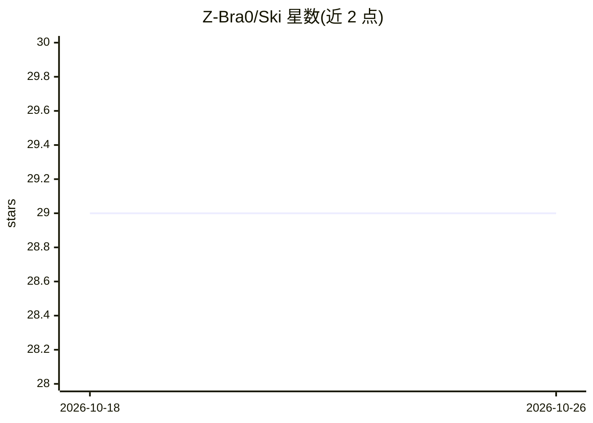

# Z-Bra0/Ski

⭐ 29 · Go · GPL-3.0 · 推送 2026-04-17 · [GitHub](https://github.com/Z-Bra0/Ski) · [官网](https://skicli.com) · 个人维护

**面向团队的 Git 基础 agent 技能包管理器**

用 Go 编写的命令行工具，把 agent 技能（skills）从 Git 仓库以包管理方式安装到 Claude、Codex、Cursor、OpenClaw 等目标，避免跨仓库复制粘贴漂移。核心机制是 ski.toml 清单、ski.lock.json 锁文件与共享技能存储：首次 add 解析锁定并复制到目标，后续 install 可从锁文件恢复，支持项目级/全局两种作用域与 enable/disable 追踪。仅支持 Git 源，信任需人工核验，不支持 Windows。

## 筛选速览

| 维度 | 判定 | 备注 |
|---|---|---|
| AI 角色 | `ai-ecosystem` | LLM/agent 周边工具 |
| 许可风险 | `viral` | GPL-3.0 |
| 部署形态 | `None` |  |
| 模型依赖 | — | README 未给出锁定关系 |
| 硬件要求 | — | 无带数字的原话,不猜 |
| 安装摩擦 | `low` | 无编译、无系统依赖或容器化 |
| 成熟度 | — | 结构信号不足 |

## 能力要点

- ski.toml 清单 + ski.lock.json 锁文件实现可复现安装与恢复
- 共享技能存储，多仓库复用同一技能
- 项目级与全局两种作用域，支持 -g 全局安装
- 覆盖 Claude、Codex、Cursor、OpenClaw 等目标

## 适用场景

- 团队在多个代码仓库间共享同一套 agent 技能
- 新 clone 项目后从锁文件恢复技能版本
- 按仓库固定技能版本、按需启停个别技能

## 场景标签

`提示工程` · 领域:Agent 开发

## 证据(README 行号)

> L3: Lightweight, Git-based toolkit for sharing agent skills across repos without copy-paste drift.
> L43: ski add git:https://github.com/anthropics/skills.git --skill skill-creator

## 星数曲线

2026-10-18 29 → 2026-10-26 29（+0）

---
*卡片 v1 · prompt 1.4 · 生成 2026-10-26 · 置信度 high · 依据 README sha `2dae24c0e153` · [字段定义](../../DATASET.md)*
