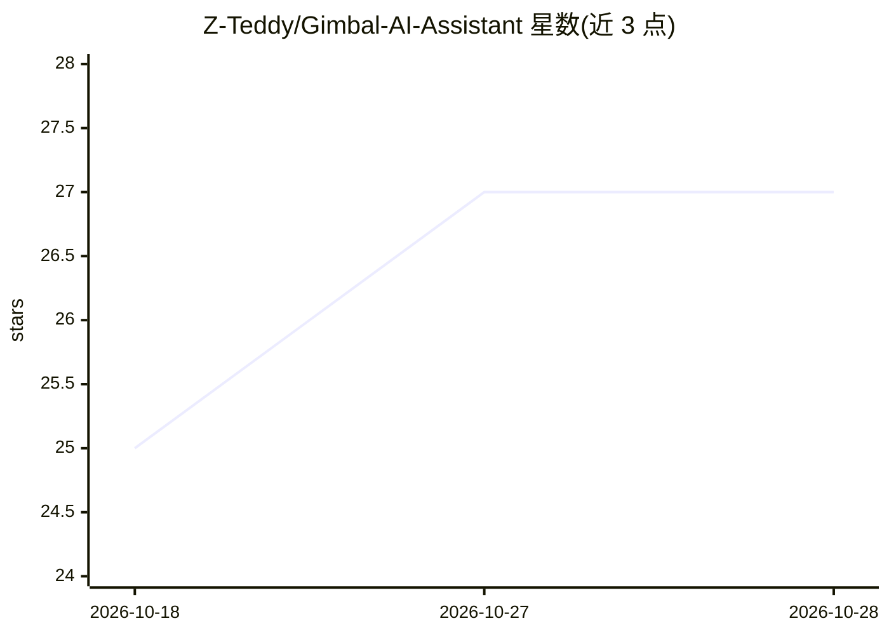

# Z-Teddy/Gimbal-AI-Assistant

⭐ 27 · C · MIT · 推送 2026-08-10 · [GitHub](https://github.com/Z-Teddy/Gimbal-AI-Assistant) · 个人维护 · 中文 README

**RK3588+STM32 嵌入式桌面智能体：离线视觉/语音/LLM 对话云台**

面向嵌入式开发者的二自由度智能云台系统：RK3588 承担视觉（RetinaFace/Haar 人脸检测与跟踪）、离线语音（SenseVoice+Silero VAD）与本地对话（RKLLM 运行 Qwen2），STM32F103 运行 FreeRTOS 执行 25 Hz PID/PWM 实时控制，经 UART 通信。常用语音控制走离线规则路径不依赖 LLM，自由对话与 RKLLM 语义功能为实验/开发路径，稳定链路与实验功能彼此隔离。目标硬件为 Orange Pi 5 Plus 与 STM32F103VET6，从源码部署。

## 筛选速览

| 维度 | 判定 | 备注 |
|---|---|---|
| AI 角色 | `ai-native` | 本体是模型或模型工具 |
| 许可风险 | `permissive` | MIT |
| 部署形态 | `library` | 以包/库形式分发 |
| 模型依赖 | — | README 未给出锁定关系 |
| 硬件要求 | — | 无带数字的原话,不猜 |
| 安装摩擦 | `low` | 无编译、无系统依赖或容器化 |
| 成熟度 | — | 结构信号不足 |

## 能力要点

- RetinaFace/Haar 人脸检测、目标跟踪与主动扫描
- SenseVoice+Silero VAD 离线语音识别与唤醒词命令解析
- RKLLM 本地运行 Qwen2（Qwen1.5 可回滚），支持 TTS 对话
- STM32+FreeRTOS 25 Hz PID/PWM 实时控制，稳定路径与实验功能隔离

## 适用场景

- 在 RK3588 开发板上搭建离线视觉跟踪与语音控制云台
- 用本地 LLM 做设备对话与语义指令实验
- 学习异构嵌入式（Linux MCU）协同的机器人项目结构

## 场景标签

`语音识别` `语音合成` `人脸识别` · 领域:内容生成

## 证据(README 行号)

> L17: |视觉|RetinaFace / Haar 人脸检测、目标跟踪与主动扫描|
> L18: |语音|SenseVoice + Silero VAD 离线识别、唤醒词和本地命令解析|
> L19: |对话|RKLLM 上运行 Qwen2，Qwen1.5 可兼容回滚|

## 星数曲线

2026-10-18 25 → 2026-10-28 27（+2）

---
*卡片 v1 · prompt 1.4 · 生成 2026-10-27 · 置信度 high · 依据 README sha `2bbafb13bef6` · [字段定义](../../DATASET.md)*
