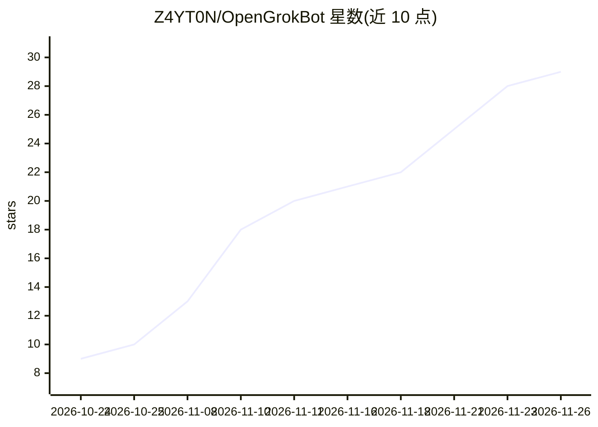

# Z4YT0N/OpenGrokBot

⭐ 29 · TypeScript · MIT · 推送 2026-10-01 · [GitHub](https://github.com/Z4YT0N/OpenGrokBot) · [官网](https://z4yt0n.github.io/OpenGrokBot/) · 个人维护 · 中文 README

**开源 Grok Bot 替代：本地群聊里运行一队可协作的 AI 员工**

Electron/浏览器的多 Agent 群聊应用：内置经理、全栈、DevOps、销售、QA 等带人格设定的 AI 员工，通过调度器把消息路由给 1-3 名相关员工，员工之间可用提及、多轮讨论协作，并能读写文件、执行命令、联网搜索、接入 MCP 服务器。模型侧通过 Claude Code Agent SDK、Codex CLI、Gemini CLI 复用已有订阅登录，或接任意 OpenAI 兼容 API（Kimi、OpenRouter、DeepSeek、Groq、xAI、Ollama）。支持审批卡片、定时任务、Webhook、长期记忆、用量统计，数据存本地 team.json，MIT 许可。界面原生支持阿拉伯语/RTL。

## 筛选速览

| 维度 | 判定 | 备注 |
|---|---|---|
| AI 角色 | `ai-native` | 本体是模型或模型工具 |
| 许可风险 | `permissive` | MIT |
| 部署形态 | `desktop` | 安装包/桌面程序 |
| 模型依赖 | local-ok | 支持本地模型 |
| 硬件要求 | — | 无带数字的原话,不猜 |
| 安装摩擦 | `low` | 无编译、无系统依赖或容器化 |
| 成熟度 | — | 结构信号不足 |

## 能力要点

- 群聊智能路由：一问只派给相关员工，@提及与轮次上限控制噪音
- 复用 Claude/ChatGPT/Gemini 订阅登录，或接任意 OpenAI 兼容 API
- 员工可读写文件、执行命令、联网搜索，并按员工配置权限与工作目录
- MCP 服务器市场一键启用，按员工分配

## 适用场景

- 让一队 AI 员工在群里讨论并分工完成开发与运营任务
- 用自己的 Claude/ChatGPT/Gemini 订阅替代 Grok Bot 付费方案
- 通过 Webhook 和定时任务让某个 AI 员工自动执行例行工作

## 场景标签

`多智能体` `编码 Agent` `工作流自动化` · 领域:Agent 开发

## 证据(README 行号)

> L3: **Looking for a Grok Bot alternative?** OpenGrokBot gives you the same thing people loved in xAI/Cursor's Grok Bot, 
> L44: - **They talk to each other, without the noise.** A fast dispatcher reads each message and picks the one to three e

## 星数曲线

2026-10-24 9 → 2026-11-26 29（+20）

---
*卡片 v1 · prompt 1.4 · 生成 2026-11-18 · 置信度 mid · 依据 README sha `d835e053678c` · [字段定义](../../DATASET.md)*
