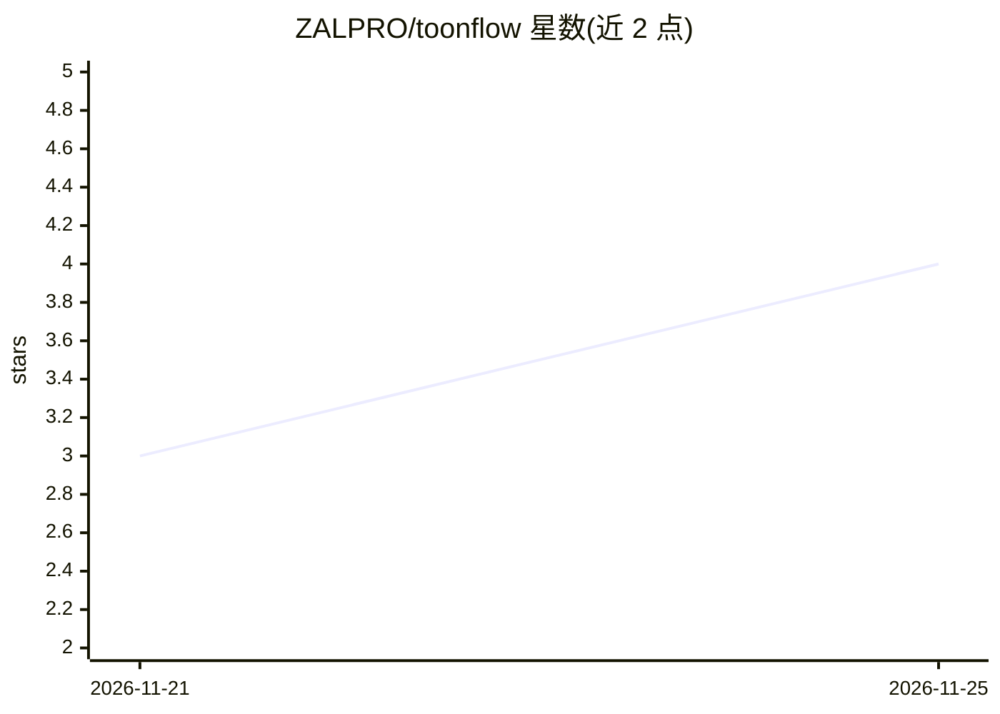

# ZALPRO/toonflow

⭐ 4 · TypeScript · MIT · 推送 2026-10-23 · [GitHub](https://github.com/ZALPRO/toonflow) · [官网](https://github.com/ZALPRO/toonflow) · 个人维护

**给创作者/AI agent 用的代码驱动 2D 动画引擎，产出解说视频与竖屏 Reels**

基于 Remotion 4 的 TypeScript 2D 动画引擎，同时以 AI Agent / Claude Code skill 形式提供。输入主题、脚本、.srt 字幕、配音或 YouTube 转录，渲染 16:9（1920×1080）与 9:16（1080×1920）格式的成品视频。关键机制包括两遍无缝描边角色系统（男/女角色、15+ 帽子配件）、自动双向 LTR/RTL 排版（支持波斯语/阿拉伯语）、25+ SVG 矢量道具库，以及程序化音频生成（34 个 WAV 音效）与基于 ElevenLabs 配音脚本的帧级对齐。安装方式为 git clone 到 Claude skills 目录并 pip 安装依赖。

## 筛选速览

| 维度 | 判定 | 备注 |
|---|---|---|
| AI 角色 | `ai-enhanced` | 去掉 AI 部分产品仍成立 |
| 许可风险 | `permissive` | MIT |
| 部署形态 | `library` | 以包/库形式分发 |
| 模型依赖 | — | README 未给出锁定关系 |
| 硬件要求 | — | 无带数字的原话,不猜 |
| 安装摩擦 | `low` | 无编译、无系统依赖或容器化 |
| 成熟度 | — | 结构信号不足 |

## 能力要点

- 两遍描边无缝角色引擎：男/女角色系统、速度混合步态、6 种表情
- 自动双向 LTR/RTL 排版，支持波斯语（fa-IR）与阿拉伯语
- 16:9 与 9:16 双舞台，9:16 含 Reels/TikTok/Shorts 安全区规范
- 程序化音频生成与帧级配音对齐（sync_elevenlabs.py）

## 适用场景

- 制作财经、历史类解说动画视频
- 批量生成 Instagram Reels/TikTok 竖屏动画内容
- 在 Claude Code 中让 AI agent 按工作流生成动画制作项目

## 场景标签

`视频生成` · 领域:内容生成

## 证据(README 行号)

> L28: **ToonFlow (`v1.0.0`)** is a deterministic, code-driven 2D comic animation engine and AI Agent / Claude Code skill 
> L61: ### 1. Install as an AI Agent / Claude Code Skill

## 星数曲线

2026-11-21 3 → 2026-11-25 4（+1）

---
*卡片 v1 · prompt 1.4 · 生成 2026-11-22 · 置信度 low · 依据 README sha `62d8f50191b4` · [字段定义](../../DATASET.md)*
