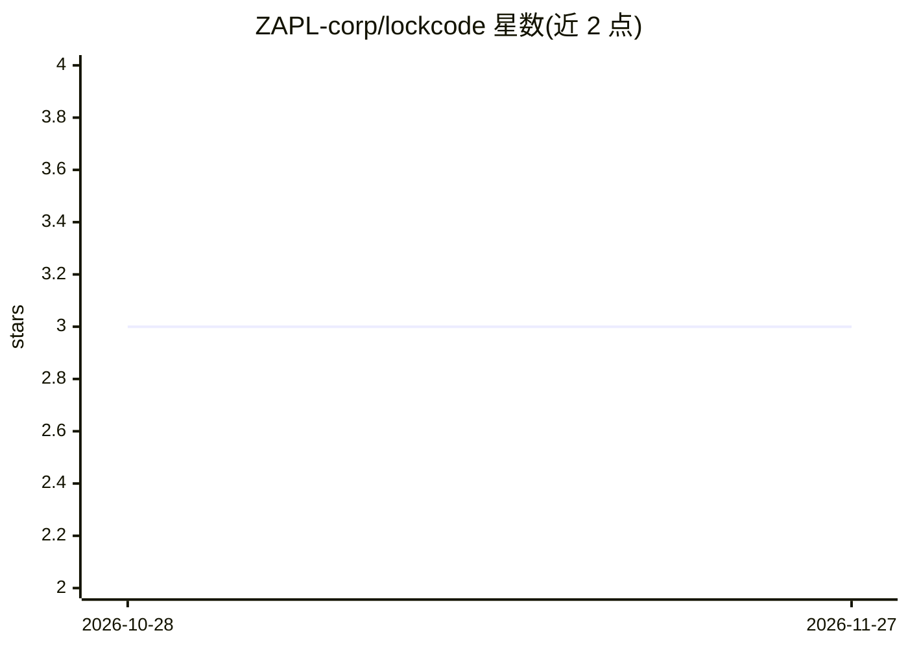

# ZAPL-corp/lockcode

⭐ 3 · JavaScript · MIT · 推送 2026-11-12 · [GitHub](https://github.com/ZAPL-corp/lockcode) · [官网](https://lockcode.pages.dev) · 组织维护

**面向终端用户的终端 AI 编码代理 CLI，直连 OpenAI 兼容 API**

以 opencode 风格运行的终端 AI 代理，提供像素风格标识、会话卡片与斜杠命令，请求通过 OpenAI 兼容 API 直接发往模型服务商，不经代理或中间层。用户通过 /add 添加服务商、模型名与 API 密钥后即可对话，密钥明文存于本地配置文件。支持多模型切换、代理模式、连接器、模型限制查询、多语言界面等命令。通过 npm 全局安装或 npx 运行，需 Node.js 14+。

## 筛选速览

| 维度 | 判定 | 备注 |
|---|---|---|
| AI 角色 | `ai-native` | 本体是模型或模型工具 |
| 许可风险 | `permissive` | MIT |
| 部署形态 | `library` | 以包/库形式分发 |
| 模型依赖 | — | README 未给出锁定关系 |
| 硬件要求 | — | 无带数字的原话,不猜 |
| 安装摩擦 | `low` | 无编译、无系统依赖或容器化 |
| 成熟度 | — | 结构信号不足 |

## 能力要点

- 直连 OpenAI 兼容 API，无代理与中间层
- 支持自定义端点（Custom 项，格式 https://host/v1）
- 斜杠命令覆盖模型管理、会话切换、内存清理、连接器等
- npm 安装或 npx 直接运行，Node.js 14+

## 适用场景

- 在终端中直接与多家模型服务商对话
- 接入自有本地或开放端点模型
- 多模型列表管理与切换

## 场景标签

`编码 Agent` · 领域:编码与开发

## 证据(README 行号)

> L5: Терминальный AI-агент в стиле opencode: пиксельный логотип, карточка сессии,
> L6: промпт `❯` и слэш-команды. Запросы уходят напрямую к провайдеру по OpenAI-совместимому
> L71: Поддерживаются OpenAI-совместимые API: OpenRouter, DeepSeek, OpenAI, Mistral, Gemini, GigaChat,

## 星数曲线

2026-10-28 3 → 2026-11-27 3（+0）

---
*卡片 v1 · prompt 1.4 · 生成 2026-11-22 · 置信度 high · 依据 README sha `d9d06c965e0c` · [字段定义](../../DATASET.md)*
