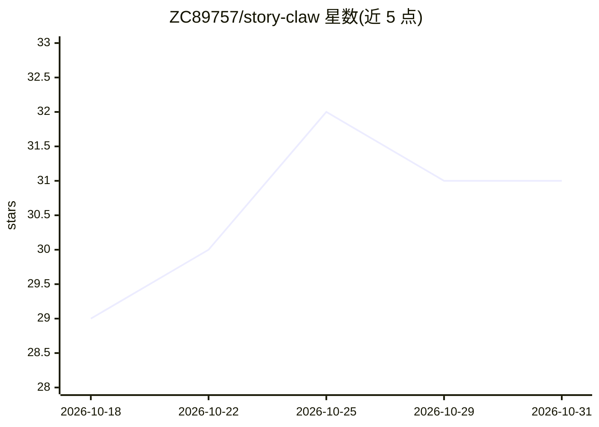

# ZC89757/story-claw

⭐ 31 · TypeScript · MIT · 推送 2026-10-22 · [GitHub](https://github.com/ZC89757/story-claw) · [官网](https://zc89757.github.io/story-claw/) · 个人维护 · 中文 README

**开源 AI 小说转视频流水线：一章小说一键产出短剧成片**

面向短剧/MG 动画/分镜制作者的本地运行流水线：输入按「第N章」命名的小说 txt 文件，经五个阶段（LLM 子代理驱动）完成改编、角色/场景参考图、分镜、配音+BGM+音效与视频渲染，输出成片。角色按服装/道具变化分阶段生成参考图以控制成本；每个角色分配持久 TTS 音色；视频由自托管 ComfyUI + MiniMax H3 参考生视频工作流渲染，按秒计费的商用视频 API 不被使用；VLM 门控检查片段一致性并自动重渲染。提供 Windows 桌面安装包、npm CLI 与源码运行三种方式；需自备 LLM/图像/TTS API key 与 ComfyUI GPU 实例；目前仅支持中文章节命名格式的 txt 文件。

## 筛选速览

| 维度 | 判定 | 备注 |
|---|---|---|
| AI 角色 | `ai-native` | 本体是模型或模型工具 |
| 许可风险 | `permissive` | MIT |
| 部署形态 | `desktop` | 安装包/桌面程序 |
| 模型依赖 | — | README 未给出锁定关系 |
| 硬件要求 | — | 无带数字的原话,不猜 |
| 安装摩擦 | `medium` | 含编译或系统依赖之一 |
| 成熟度 | — | 结构信号不足 |

## 能力要点

- 小说章节→短剧成片的端到端五阶段流水线（脚本改编→美术→分镜→语音音效→渲染）
- 角色/场景分阶段参考图机制，按章节判断是否需要新图，控制长篇美术成本
- 自托管 ComfyUI + MiniMax H3 参考生视频渲染，无需按秒付费的视频 API
- 每角色持久 TTS 音色映射与 VLM 门控自动重渲染

## 适用场景

- 把长篇网文批量改编为短剧剧集而不手工处理角色一致性
- 在自有 GPU 上渲染短剧/MG 动画，避免按秒计费的视频生成服务
- 制作带配音、BGM 与音效的成品短剧集

## 场景标签

`视频生成` `图像生成` `语音合成` · 领域:内容生成

## 证据(README 行号)

> L12: Story Claw is an open-source, AI-powered novel-to-video pipeline for short-drama episodes, MG animation, and storyb
> L26: *Click to play full video. Generated end-to-end by Story Claw, zero manual editing: script adaptation → character/s
> L44: Five stages per episode, each driven by an LLM sub-agent or direct API calls:

## 星数曲线

2026-10-18 29 → 2026-10-31 31（+2）

---
*卡片 v1 · prompt 1.4 · 生成 2026-10-26 · 置信度 high · 依据 README sha `58f69841befe` · [字段定义](../../DATASET.md)*
