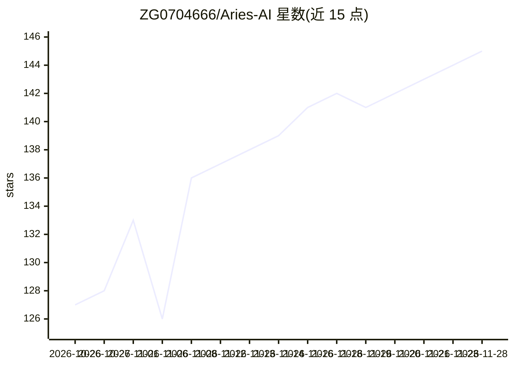

# ZG0704666/Aries-AI

⭐ 145 · Kotlin · AGPL-3.0 · 推送 2026-11-25 · [GitHub](https://github.com/ZG0704666/Aries-AI) · [官网](https://aries-agent.com) · 个人维护 · 中文 README

**安卓端 AI Agent：自然语言自动操控手机跨应用执行任务**

开源 Android UI 自动化引擎，通过接入大语言模型理解屏幕内容并执行跨应用任务。提供三种模型接入：第三方 OpenAI 兼容 API、Aries API、本地 MNN（预置 Qwen3.5-9B）；执行侧支持虚拟屏隔离、无障碍/Shizuku 输入、截图缓存与流式解析，并内置 sherpa-onnx 离线语音识别。用户通过 Releases APK 安装，需 Android 11+、ARM64 设备、无障碍服务权限与 Shizuku；界面理解依赖模型支持图像输入，任务完成情况取决于模型、应用与设备环境。

## 筛选速览

| 维度 | 判定 | 备注 |
|---|---|---|
| AI 角色 | `ai-native` | 本体是模型或模型工具 |
| 许可风险 | `viral` | AGPL-3.0 |
| 部署形态 | `None` |  |
| 模型依赖 | — | README 未给出锁定关系 |
| 硬件要求 | — | 无带数字的原话,不猜 |
| 安装摩擦 | `medium` | 含编译或系统依赖之一 |
| 成熟度 | — | 结构信号不足 |

## 能力要点

- 虚拟屏自动化：独立显示、焦点管理与定向输入，主屏可继续使用
- 三种模型接入模式：OpenAI 兼容 API / Aries API / 本地 MNN（Qwen3.5-9B）
- sherpa-onnx 离线语音识别（X-ASR-zh-en，设备端运行）
- 提供预设任务（餐厅/火车票/机票预订）与实时预览窗口

## 适用场景

- 用自然语言让 AI 帮我在携程订机票、在美团订餐厅
- 把重复的跨应用界面操作交给后台虚拟屏执行
- 在设备端用本地 MNN 模型离线运行自动化任务
- 辅助应用测试中的界面操作流程

## 场景标签

`GUI 自动化` · 领域:效率与自动化

## 证据(README 行号)

> L9: 用自然语言描述目标，让 AI 理解手机界面、规划步骤并执行操作。
> L20: Aries AI 是一个开源的 Android UI 自动化引擎，通过接入大语言模型，让 AI 理解屏幕内容并自动执行复杂任务。
> L63: |第三方 API|配置 Base URL、模型名称和 API Key|接入提供 OpenAI 兼容聊天接口的服务或自部署模型|

## 星数曲线

2026-10-26 127 → 2026-11-28 145（+18）

---
*卡片 v1 · prompt 1.4 · 生成 2026-11-27 · 置信度 high · 依据 README sha `c6417806f405` · [字段定义](../../DATASET.md)*
