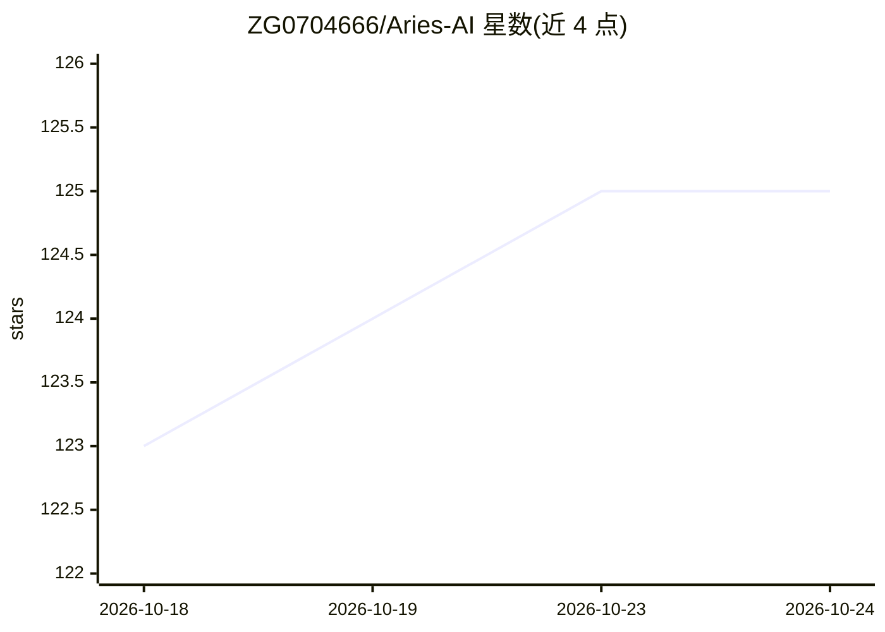

# ZG0704666/Aries-AI

⭐ 125 · Kotlin · AGPL-3.0 · 推送 2026-10-21 · [GitHub](https://github.com/ZG0704666/Aries-AI) · [官网](https://aries-agent.com) · 个人维护 · 中文 README

**开源 Android AI Agent：自然语言驱动自动操控手机跨应用完成任务**

Android UI 自动化引擎应用：接入大语言模型后，AI 读取屏幕截图与 UI 状态、规划步骤并通过无障碍、Shizuku 或虚拟屏路径执行输入，完成跨应用查询、预订等任务。提供第三方 OpenAI 兼容 API、Aries API 与本地 MNN（预置 Qwen3.5-9B MNN）三种模型接入模式，另含 Sherpa-ncnn 离线语音识别。虚拟屏隔离与输入定向依赖设备与系统兼容性，需实机验证；当前版本为 2.0.0 Alpha，AGPL-3.0 开源。

## 筛选速览

| 维度 | 判定 | 备注 |
|---|---|---|
| AI 角色 | `ai-native` | 本体是模型或模型工具 |
| 许可风险 | `viral` | AGPL-3.0 |
| 部署形态 | `None` |  |
| 模型依赖 | — | README 未给出锁定关系 |
| 硬件要求 | — | 无带数字的原话,不猜 |
| 安装摩擦 | `high` | 编译与系统依赖俱全 |
| 成熟度 | `idea` | |

## 能力要点

- 虚拟屏执行链路：焦点管理、定向输入与实时预览，减少后台任务对主屏干扰
- 三种模型接入：OpenAI 兼容 API / Aries API / 本地 MNN（预置 Qwen3.5-9B）
- Sherpa-ncnn 设备端离线语音识别
- 按系统能力在无障碍、Shizuku、虚拟屏三种输入路径间适配

## 适用场景

- 用自然语言指令在多个应用间完成查询、预订等复杂任务
- 自动化重复性的界面操作
- 在虚拟屏后台执行任务，主屏同时使用其他应用

## 场景标签

`GUI 自动化` · 领域:效率与自动化

## 证据(README 行号)

> L20: Aries AI 是一个开源的 Android UI 自动化引擎，通过接入大语言模型，让 AI 理解屏幕内容并自动执行复杂任务。
> L63: |第三方 API|配置 Base URL、模型名称和 API Key|接入提供 OpenAI 兼容聊天接口的服务或自部署模型|

## 星数曲线

2026-10-18 123 → 2026-10-24 125（+2）

---
*卡片 v1 · prompt 1.4 · 生成 2026-10-23 · 置信度 high · 依据 README sha `a329f7634f7e` · [字段定义](../../DATASET.md)*
