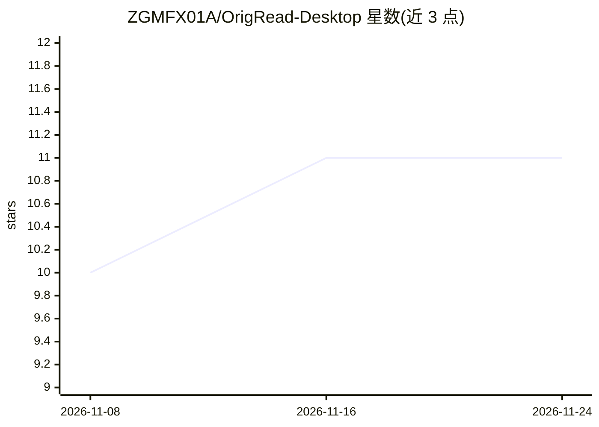

# ZGMFX01A/OrigRead-Desktop

⭐ 11 · TypeScript · AGPL-3.0 · 推送 2026-11-18 · [GitHub](https://github.com/ZGMFX01A/OrigRead-Desktop) · 个人维护 · 中文 README

**面向 RSS 读者的桌面应用，提供可核验的 AI 引用阅读**

跨 Windows/macOS/Linux 的 Electron 桌面 RSS 阅读器，将订阅源、全文抓取与 AI 阅读工具放在同一界面，支持文章与 AI 并排显示。核心机制是引用溯源：点击 AI 回答中的引用可定位并高亮原文，保存的回答保留当时的来源。支持 OpenAI 兼容云端、自托管与本地模型服务，MCP 工具执行前需确认；订阅、解析与全文提取在本地运行，日常使用无需配置 AI。

## 筛选速览

| 维度 | 判定 | 备注 |
|---|---|---|
| AI 角色 | `ai-enhanced` | 去掉 AI 部分产品仍成立 |
| 许可风险 | `viral` | AGPL-3.0 |
| 部署形态 | `desktop` | 安装包/桌面程序 |
| 模型依赖 | — | README 未给出锁定关系 |
| 硬件要求 | — | 无带数字的原话,不猜 |
| 安装摩擦 | `low` | 无编译、无系统依赖或容器化 |
| 成熟度 | — | 结构信号不足 |

## 能力要点

- AI 回答可点击引用定位并高亮原文段落
- 支持 OpenAI 兼容云端、自托管与本地模型服务，及远程/本地 MCP 工具
- 无 RSS 的网站可从网页、JSON/API、RSSHub 路由发现订阅源
- 多语言界面（含中文）与 OPML 导入、FreshRSS 等同步

## 适用场景

- 订阅博客与新闻并在同一窗口对照 AI 分析核验原文
- 用 AI 对比同一事件的多篇报道并逐条查证引用
- 把无订阅按钮的网站转为可跟踪的内容源

## 场景标签

`文档问答` · 领域:知识与检索

## 证据(README 行号)

> L4:  A reader for Windows, macOS, and Linux that brings your feeds, full articles, and AI reading tools together.
> L82: OrigRead supports OpenAI-compatible cloud providers, self-hosted services, and local model services. Quick Messages
> L84: Configure these as they become useful. Everyday subscriptions, extraction, and reading work without AI. See the AI,

## 星数曲线

2026-11-08 10 → 2026-11-24 11（+1）

---
*卡片 v1 · prompt 1.4 · 生成 2026-11-18 · 置信度 high · 依据 README sha `3ed8a1639fdd` · [字段定义](../../DATASET.md)*
