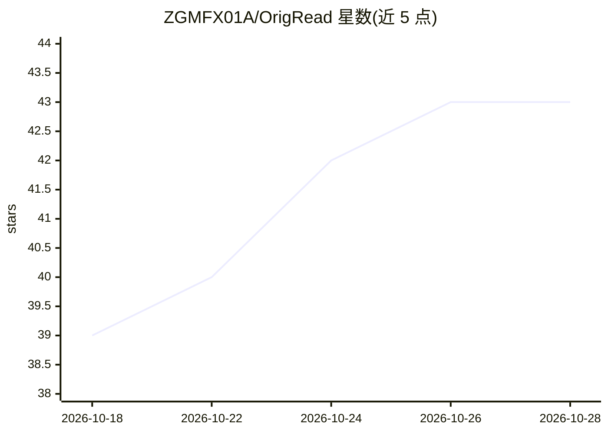

# ZGMFX01A/OrigRead

⭐ 43 · Kotlin · AGPL-3.0 · 推送 2026-10-18 · [GitHub](https://github.com/ZGMFX01A/OrigRead) · 个人维护 · 中文 README

**带 AI 引用溯源的 Android RSS 全文阅读器**

基于 Read You 的 Android 平板/手机 RSS 阅读器，支持全文抓取、来源发现（RSS/Atom、RSSHub 路由、网页列表与 JSON API 解析、浏览器渲染）、段落对照翻译与 TTS。AI 部分为可选的阅读助手：回答附 [1][2] 引用标记，可从答案定位到原文段落高亮，也可从文章反向跳回引用它的对话；支持 OpenAI 兼容云端、自托管或本地模型服务及 MCP 工具接入。常规订阅与阅读无需配置 AI。提供 APK 下载（ARM64、Android 8.0+）与桌面版。

## 筛选速览

| 维度 | 判定 | 备注 |
|---|---|---|
| AI 角色 | `ai-enhanced` | 去掉 AI 部分产品仍成立 |
| 许可风险 | `viral` | AGPL-3.0 |
| 部署形态 | `None` |  |
| 模型依赖 | — | README 未给出锁定关系 |
| 硬件要求 | — | 无带数字的原话,不猜 |
| 安装摩擦 | `medium` | 含编译或系统依赖之一 |
| 成熟度 | — | 结构信号不足 |

## 能力要点

- AI 回答与文章段落的双向引用定位（含高亮与上下文）
- 无现成 feed 时从网页列表/JSON API/WordPress API/Next.js 内嵌数据发现来源，并可让 AI 辅助生成解析规则
- 支持 OpenAI 兼容服务（云端/自托管/本地）与 MCP 工具接入
- 段落对照翻译（端侧/云端/AI）与 TTS，配置备份默认排除 API key

## 适用场景

- 在一个应用里订阅博客和新闻并阅读全文
- 读文章时向 AI 提问并沿引用核对原文说法
- 关注没有 RSS 的网站，用解析规则或网页列表转为可订阅来源
- 在平板大屏上并排阅读文章与 AI 对话

## 场景标签

`文档问答` `语音合成` · 领域:内容生成

## 证据(README 行号)

> L4:  An Android RSS reader that brings your feeds, full articles, and AI reading tools together.
> L76: OrigRead supports OpenAI-compatible services, so you can choose a cloud provider, a self-hosted service, or a local
> L78: All of this is optional. Feeds and everyday reading work without AI configuration. Start reading, and add the tools

## 星数曲线

2026-10-18 39 → 2026-10-28 43（+4）

---
*卡片 v1 · prompt 1.4 · 生成 2026-10-25 · 置信度 high · 依据 README sha `b33122457a94` · [字段定义](../../DATASET.md)*
