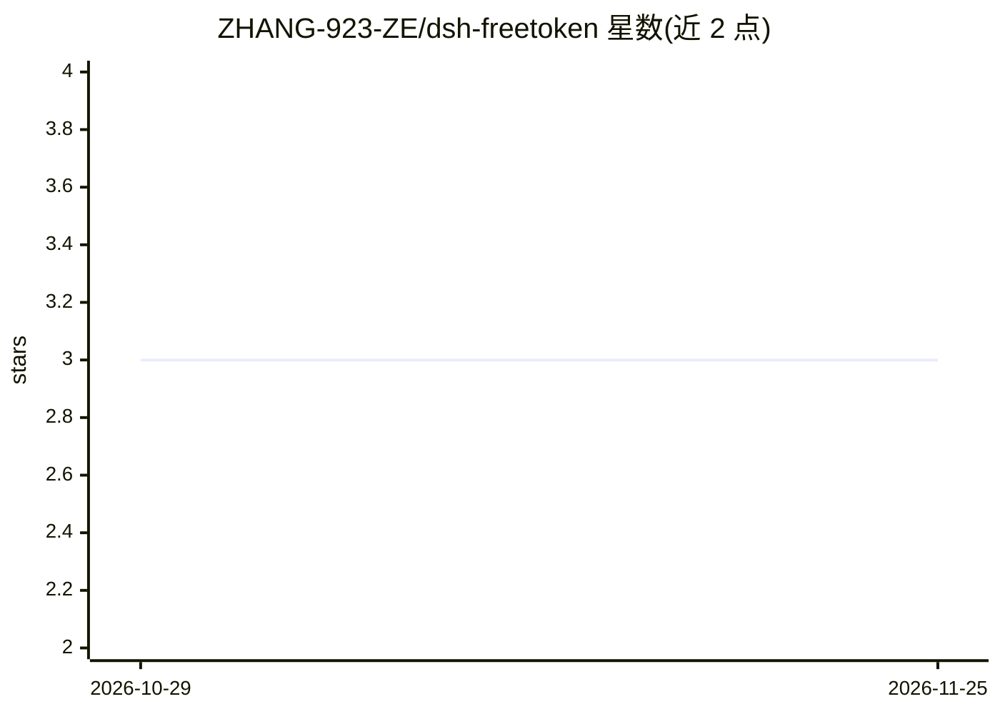

# ZHANG-923-ZE/dsh-freetoken

⭐ 3 · TypeScript · Apache-2.0 · 推送 2026-10-26 · [GitHub](https://github.com/ZHANG-923-ZE/dsh-freetoken) · 个人维护 · 中文 README

**把 DeepSeek 网页版桥接为 DSH 插件 provider 的非官方工具**

非官方 DSH 插件，通过真实浏览器（Edge/Chrome CDP）驱动 chat.deepseek.com 网页版，将其封装为宿主的 `deepseek-web` provider，与官方 API provider 并列共存。支持浏览器内手动登录并捕获凭证、PoW 求解、文本/文件/图片链路、会话常驻与 keep-alive 自愈、请求节奏控制（抖动/退避/静默）。默认关闭，构建走 tsc，需 Node 与桌面版 DSH；README 明示违反 DeepSeek 服务条款的账号风控风险。

## 筛选速览

| 维度 | 判定 | 备注 |
|---|---|---|
| AI 角色 | `ai-ecosystem` | LLM/agent 周边工具 |
| 许可风险 | `permissive` | Apache-2.0 |
| 部署形态 | `library` | 以包/库形式分发 |
| 模型依赖 | locked-api |  |
| 硬件要求 | — | 无带数字的原话,不猜 |
| 安装摩擦 | `low` | 无编译、无系统依赖或容器化 |
| 成熟度 | — | 结构信号不足 |

## 能力要点

- 以浏览器 CDP 方式驱动 DeepSeek 网页版并封装为 `deepseek-web` provider
- 登录态常驻：每 60s 本地 CDP 探测，浏览器误关可自动重新拉起
- 请求节奏控制：发送前 2–5s 抖动、失败指数退避、每 20 次请求后静默
- 关闭态零副作用，重模块经懒加载边界加载

## 适用场景

- 在 DSH 桌面端免费使用 DeepSeek 网页版额度做偶尔问答
- 官方 API 被限流或掉登录时临时切换网页版入口
- 在隔离 profile 中试跑网页版链路，避免污染主环境

## 场景标签

`模型网关` `浏览器自动化` · 领域:Agent 开发

## 证据(README 行号)

> L3: Unofficial DSH plugin that bridges **chat.deepseek.com web** into DeepSeek Harness as the
> L129: 本插件**不占用**任何已有的 provider：它只是新增一个 `deepseek-web`（显示名「DeepSeek 网页」），
> L130: 和宿主自带的 `deepseek-account`（官方 API）以及其它第三方 provider **并列共存**。

## 星数曲线

2026-10-29 3 → 2026-11-25 3（+0）

---
*卡片 v1 · prompt 1.4 · 生成 2026-11-22 · 置信度 high · 依据 README sha `05e2c2978337` · [字段定义](../../DATASET.md)*
