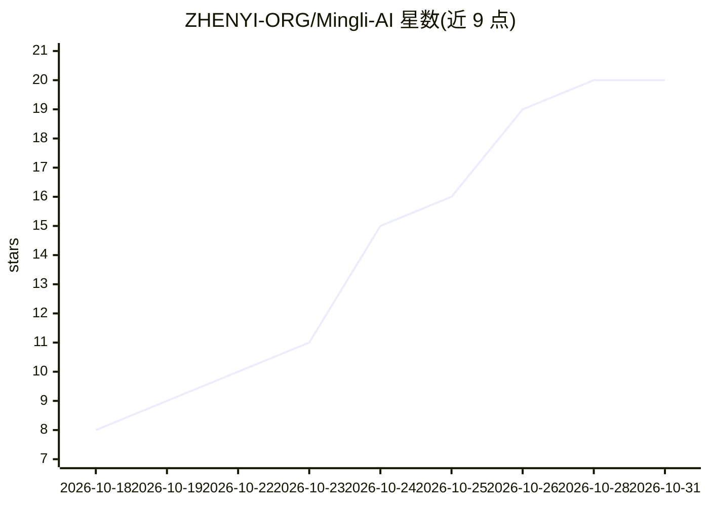

# ZHENYI-ORG/Mingli-AI

⭐ 20 · TypeScript · MIT · 推送 2026-10-27 · [GitHub](https://github.com/ZHENYI-ORG/Mingli-AI) · [官网](https://www.zhenyi.org) · 组织维护 · 中文 README

**开源八字命理大模型：排盘程序计算四柱，模型负责推演**

真一 ZHENYI 是 27B 参数的开源算命命理大模型（BF16 合并版权重），以盲派做功技法训练，融合旺衰、子平、调候方法。使用流程：用户提交出生资料，配套程序自动计算四柱与岁运，模型结合排盘结果回答问题，日常聊天走同一接口。推理入口为 OpenAI 兼容的 /v1/chat/completions。提供模型权重下载（分卷还原、SHA-256 校验）、排盘源码、聊天后端、网页与部署脚本；部署需 Node.js 20+、Python 3 及 ms-swift 推理环境，并需支持 BF16 的推理硬件。训练原文与命例答案未公开。

## 筛选速览

| 维度 | 判定 | 备注 |
|---|---|---|
| AI 角色 | `ai-native` | 本体是模型或模型工具 |
| 许可风险 | `permissive` | MIT |
| 部署形态 | `None` |  |
| 模型依赖 | — | README 未给出锁定关系 |
| 硬件要求 | — | 无带数字的原话,不猜 |
| 安装摩擦 | `low` | 无编译、无系统依赖或容器化 |
| 成熟度 | — | 结构信号不足 |

## 能力要点

- 27B BF16 合并版权重，无需另行加载 LoRA
- 程序排盘（四柱、岁运）+ 模型推演的工作流程
- OpenAI 兼容 API（/v1/chat/completions，支持多轮与流式）
- 开源权重、排盘源码、后端、网页与部署脚本

## 适用场景

- 在线体验或私有部署 AI 八字命理分析
- 通过 OpenAI 兼容客户端调用命理推演 API
- 在自有服务器上二次开发命理模型应用

## 场景标签

`聊天机器人` · 领域:对话与助手

## 证据(README 行号)

> L7: 我们把盲派做功技法训练进模型，同时吸收旺衰、子平、调候的判断方法。用户发来出生资料，程序自动排盘；真一结合命局与岁运，围绕具体问题展开推演。
> L25: |推理入口|OpenAI 兼容的 `/v1/chat/completions` 和 `/v1/models`|
> L35: 出生信息不全时，后端会先请用户补充。资料齐全后，程序计算四柱和岁运，模型根据排盘结果作答。日常聊天也走同一个接口。实现细节见 部署文档。

## 星数曲线

2026-10-18 8 → 2026-10-31 20（+12）

---
*卡片 v1 · prompt 1.4 · 生成 2026-10-28 · 置信度 high · 依据 README sha `9ba4c02ee339` · [字段定义](../../DATASET.md)*
