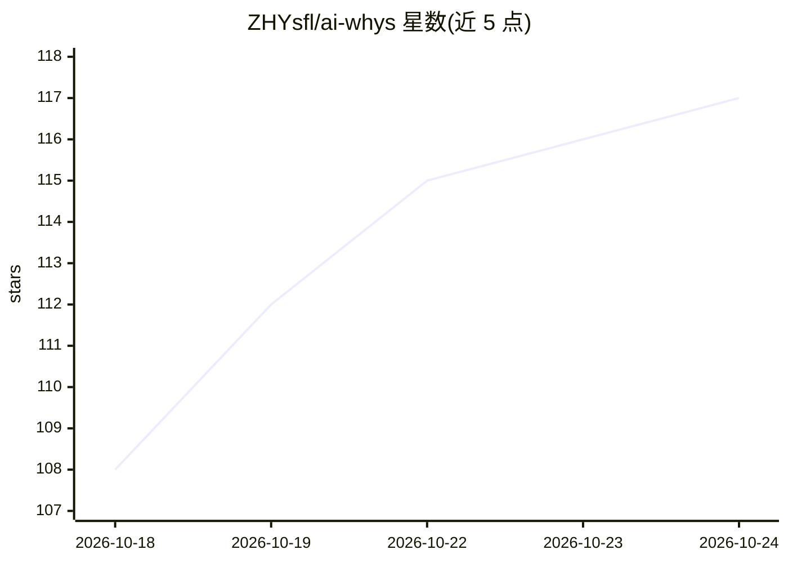

# ZHYsfl/ai-whys

⭐ 117 · Python · Apache-2.0 · 推送 2026-10-22 · [GitHub](https://github.com/ZHYsfl/ai-whys) · 个人维护 · 中文 README

**深度学习与强化学习学习路线：39 个从零实现实验配推导笔记**

上海交通大学博士生个人维护的学习项目，由 39 个实验与 17 章笔记组成，覆盖线性回归到 CNN/ResNet、RNN 到 Transformer/BERT、Q-learning 到 PPO。每个实验包含三部分：数学推导笔记（dl.md/rl.md）、30 余张 Excalidraw 手绘插图（pics/）、可运行代码（code/），代码分从零手写与 PyTorch API 两版。面向有 Python 基础、想系统梳理 ML/DL 知识的本科生与准研究生，建议配合 AI coding agent 使用。深度学习代码改写自《动手学深度学习》，强化学习代码改写自《动手学强化学习》并迁移至 gymnasium 最新版 API。

## 筛选速览

| 维度 | 判定 | 备注 |
|---|---|---|
| AI 角色 | `ai-knowledge` | 知识聚合/清单类 |
| 许可风险 | `permissive` | Apache-2.0 |
| 部署形态 | `library` | 以包/库形式分发 |
| 模型依赖 | — | README 未给出锁定关系 |
| 硬件要求 | — | 无带数字的原话,不猜 |
| 安装摩擦 | `low` | 无编译、无系统依赖或容器化 |
| 成熟度 | — | 结构信号不足 |

## 能力要点

- 39 个实验各配数学推导、插图与可运行代码三件套
- 代码分从零手写与 PyTorch API 两个版本，附中文注释
- PPO 等强化学习实验已迁移至 gymnasium 最新版 API
- Apache 2.0 开源，笔记与插图为原创内容

## 适用场景

- 按实验 1→39 顺序系统入门深度学习与强化学习
- 入学前用实验清单自查基础知识掌握程度
- 配合 AI coding agent 逐行讲解代码与补齐推导

## 场景标签

`教程课程` · 领域:学习与行业

## 证据(README 行号)

> L6: > 一个系统性的 AI 学习路线：**39 个实验、17 章笔记**，从线性回归到 BERT、从 Q-learning 到 PPO，每个算法都从零实现，并讲清每个"为什么"。
> L12: ## 39 个实验
> L72: - **想系统性学 AI、但不知道从何开始的本科生**——不需要先修成堆的理论，跟着实验 1 → 39 的顺序走，就是一条完整的深度学习 + 强化学习入门路线。

## 星数曲线

2026-10-18 108 → 2026-10-24 117（+9）

---
*卡片 v1 · prompt 1.4 · 生成 2026-10-23 · 置信度 mid · 依据 README sha `5d86ab791295` · [字段定义](../../DATASET.md)*
