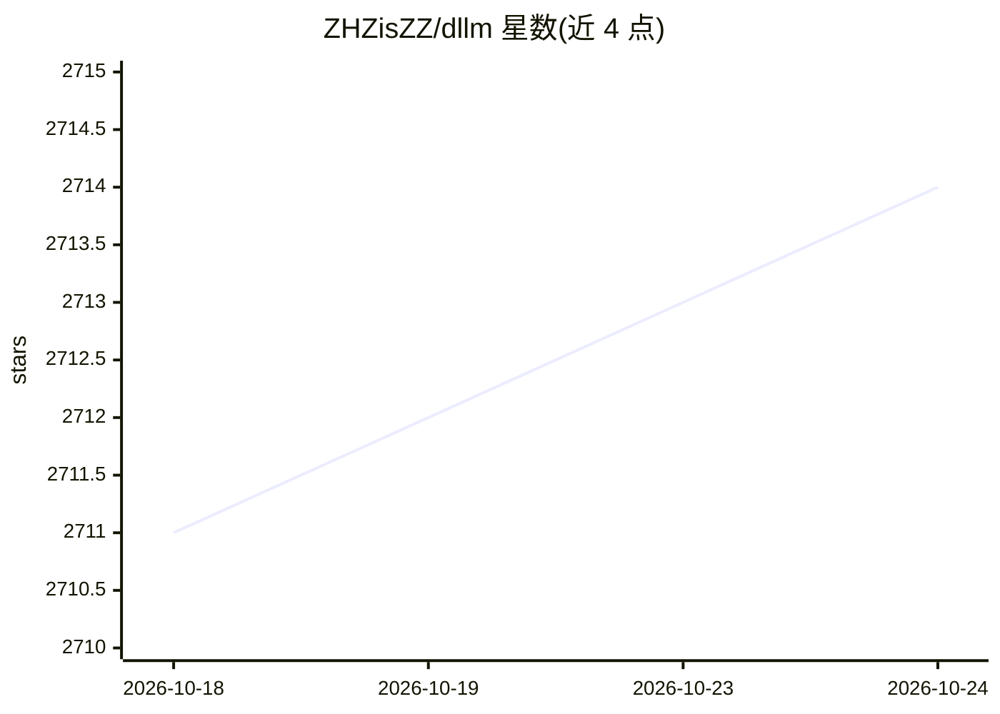

# ZHZisZZ/dllm

⭐ 2,714 · Python · Apache-2.0 · 推送 2026-07-17 · [GitHub](https://github.com/ZHZisZZ/dllm) · [官网](https://arxiv.org/pdf/2602.22661) · 组织维护

**扩散语言模型统一训练与评测库，面向研究者**

dLLM 是一个统一扩散语言模型（diffusion language models）训练与评测的 Python 库。训练管线基于 transformers Trainer，支持 LoRA、DeepSpeed、FSDP、4bit 量化等；评测管线基于 lm-evaluation-harness。提供 LLaDA、Dream 等开放权重模型的最小训练/推理/评测配方，以及 MDLM、BD3-LM、Edit Flows 等算法实现，另含 diffu-GRPO 强化学习训练与 Fast-dLLM 加速推理。通过 conda 环境源码方式安装，支持本地 accelerate 启动与 Slurm 集群提交。

## 筛选速览

| 维度 | 判定 | 备注 |
|---|---|---|
| AI 角色 | `ai-ecosystem` | LLM/agent 周边工具 |
| 许可风险 | `permissive` | Apache-2.0 |
| 部署形态 | `library` | 以包/库形式分发 |
| 模型依赖 | — | README 未给出锁定关系 |
| 硬件要求 | — | 无带数字的原话,不猜 |
| 安装摩擦 | `low` | 无编译、无系统依赖或容器化 |
| 成熟度 | — | 结构信号不足 |

## 能力要点

- 基于 transformers Trainer 的可扩展训练管线，支持 LoRA/DeepSpeed/FSDP/4bit 量化
- 基于 lm-evaluation-harness 的统一评测管线
- 提供 LLaDA、Dream 等模型与 MDLM、BD3-LM、Edit Flows 等算法的配方与实现
- 支持 diffu-GRPO 强化学习训练与 Fast-dLLM 加速推理

## 适用场景

- 训练或微调扩散语言模型并做基准评测
- 将自回归模型（Qwen/LLaMA/GPT-2）转换为扩散模型的复现实验
- 在 Slurm 集群上多 GPU 分布式训练扩散语言模型

## 场景标签

`模型训练` `微调` `模型评测` `强化学习` · 领域:评测与运维

## 证据(README 行号)

> L12: **dLLM** is a library that unifies the training and evaluation of **diffusion language models**, bringing transpare
> L16: - dLLM provides unified evaluation pipelines (based on `lm-evaluation-harness`) that abstracts away inference detai
> L18: - Built on these components, dLLM provides the minimal **training / inference / evaluation** recipes for open-weigh

## 星数曲线

2026-10-18 2,711 → 2026-10-24 2,714（+3）

---
*卡片 v1 · prompt 1.4 · 生成 2026-10-21 · 置信度 high · 依据 README sha `4d1c65944865` · [字段定义](../../DATASET.md)*
