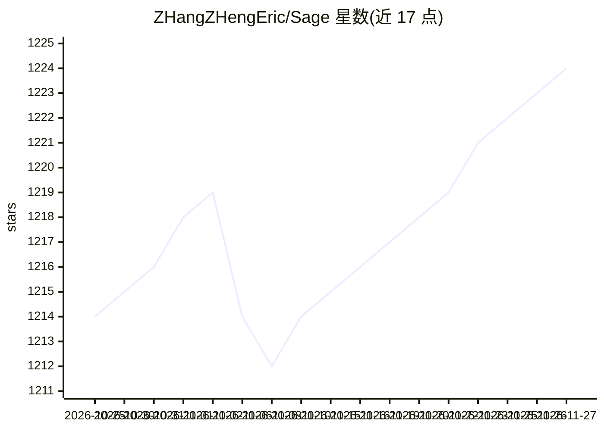

# ZHangZHengEric/Sage

⭐ 1,224 · Python · MIT · 推送 2026-11-26 · [GitHub](https://github.com/ZHangZHengEric/Sage) · [官网](https://zhangzhengeric.github.io/Sage/) · 个人维护 · 中文 README

**RSI Agent Harness：运行、评估并迭代进化 agent**

Sage 是一个 RSI（递归自我改进）Agent Harness，围绕目标或整理的使用历史运行 Runner 执行、独立 Evaluator 评分与 Tuner 优化，保留每个版本及其证据，由用户决定是否采纳。以 Desktop（Flutter 安装包）、Server（多用户 Web 与 Agent Studio）和 SAgents Python SDK 三种形态提供，支持 Skills、MCP 工具、有状态会话、多 agent 编排、沙箱与审批。Server 目前仅支持单 worker，本地执行不做容器隔离，RSI 只产出候选版本而不自动激活。

## 筛选速览

| 维度 | 判定 | 备注 |
|---|---|---|
| AI 角色 | `ai-ecosystem` | LLM/agent 周边工具 |
| 许可风险 | `permissive` | MIT |
| 部署形态 | `library` | 以包/库形式分发 |
| 模型依赖 | — | README 未给出锁定关系 |
| 硬件要求 | — | 无带数字的原话,不猜 |
| 安装摩擦 | `low` | 无编译、无系统依赖或容器化 |
| 成熟度 | — | 结构信号不足 |

## 能力要点

- RSI 循环：Runner 执行、独立 Evaluator 评分、Tuner 优化与版本选择
- Desktop/Server/Python SDK 三种宿主形态
- 支持 Skills、MCP 服务与 host 管理的授权
- 原生交互 UI：流式 Glass 界面、图表与可编辑 PPTX 导出

## 适用场景

- 用任务反馈迭代优化 agent 包并保留版本证据
- 通过 Python SDK 在自有应用中嵌入有状态 agent 运行时
- 搭建多用户 Web 端访问与 Agent Studio 管理 agent 包

## 场景标签

`多智能体` `Agent 框架` · 领域:Agent 开发

## 证据(README 行号)

> L13: **Sage is an RSI Agent Harness** for improving agents through task feedback. RSI (Recursive Self-Improvement) start
> L15:  Run · Evaluate · Evolve; Models and Context, Skills and MCP, Stateful Execution, Multi-agent, Sandbox and Approval
> L43: |🧠 **SAgents** — Build and optimize agents through Python|Runtime quick start|

## 星数曲线

2026-10-25 1,214 → 2026-11-27 1,224（+10）

---
*卡片 v1 · prompt 1.4 · 生成 2026-11-26 · 置信度 high · 依据 README sha `4d670bfb09f2` · [字段定义](../../DATASET.md)*
