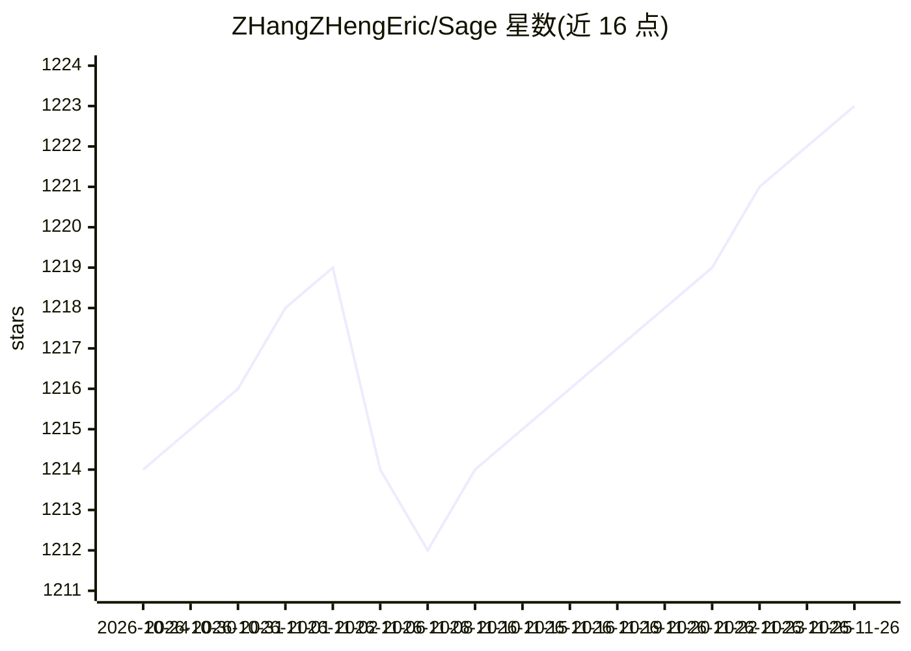

# ZHangZHengEric/Sage

⭐ 1,223 · Python · MIT · 推送 2026-11-25 · [GitHub](https://github.com/ZHangZHengEric/Sage) · [官网](https://zhangzhengeric.github.io/Sage/) · 个人维护 · 中文 README

**面向开发者的 RSI Agent 运行框架：运行、评估并迭代 agent**

Sage 是一个 RSI（递归自我改进）Agent Harness：由目标或整理后的使用历史驱动 Runner 执行、Evaluator 独立评分、Tuner 优化与版本选择，每个候选版本连同证据被保留，是否采用由用户决定。提供四种形态：Flutter 桌面端（含安装包与语音交互）、多用户 Server/Agent Studio、Python SDK（SAgents）以及离线演练。能力覆盖 sage.yaml 定义 agent 包、Skills/MCP 组合、有状态会话、沙箱与审批、多 agent 工作流。限制包括 Server 仅支持单 worker、本地执行非容器隔离。

## 筛选速览

| 维度 | 判定 | 备注 |
|---|---|---|
| AI 角色 | `ai-ecosystem` | LLM/agent 周边工具 |
| 许可风险 | `permissive` | MIT |
| 部署形态 | `library` | 以包/库形式分发 |
| 模型依赖 | — | README 未给出锁定关系 |
| 硬件要求 | — | 无带数字的原话,不猜 |
| 安装摩擦 | `low` | 无编译、无系统依赖或容器化 |
| 成熟度 | — | 结构信号不足 |

## 能力要点

- Runner-Evaluator-Tuner 的 RSI 闭环与版本/证据保留
- Desktop/Server/Python SDK/离线演练四种入口
- Skills、MCP、沙箱审批与多 agent 工作流编排
- 原生交互式 UI 流式渲染与可编辑 PPTX 导出

## 适用场景

- 构建并通过任务反馈迭代优化自己的 agent 包
- 通过 Server 为团队提供多用户 agent 访问与 Agent Studio 管理
- 在 Python 应用中嵌入 SAgents 运行时执行任务
- 在桌面端通过语音与 agent 对话并控制工具调用

## 场景标签

`Agent 框架` `多智能体` · 领域:Agent 开发

## 证据(README 行号)

> L13: **Sage is an RSI Agent Harness** for improving agents through task feedback. RSI (Recursive Self-Improvement) start
> L15:  Run · Evaluate · Evolve; Models and Context, Skills and MCP, Stateful Execution, Multi-agent, Sandbox and Approval
> L122: |🖥️ **Multiple hosts**|Use Desktop, Server/Studio, or embed SAgents in your Python application.|

## 星数曲线

2026-10-24 1,214 → 2026-11-26 1,223（+9）

---
*卡片 v1 · prompt 1.4 · 生成 2026-11-23 · 置信度 high · 依据 README sha `ac9a298e083b` · [字段定义](../../DATASET.md)*
